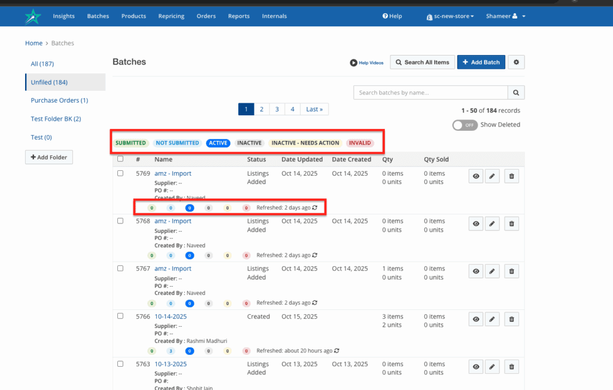
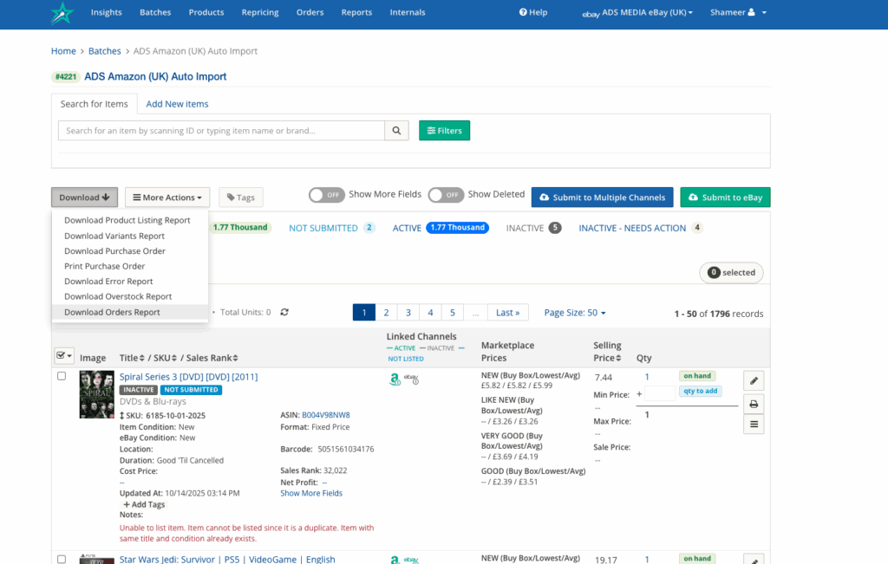
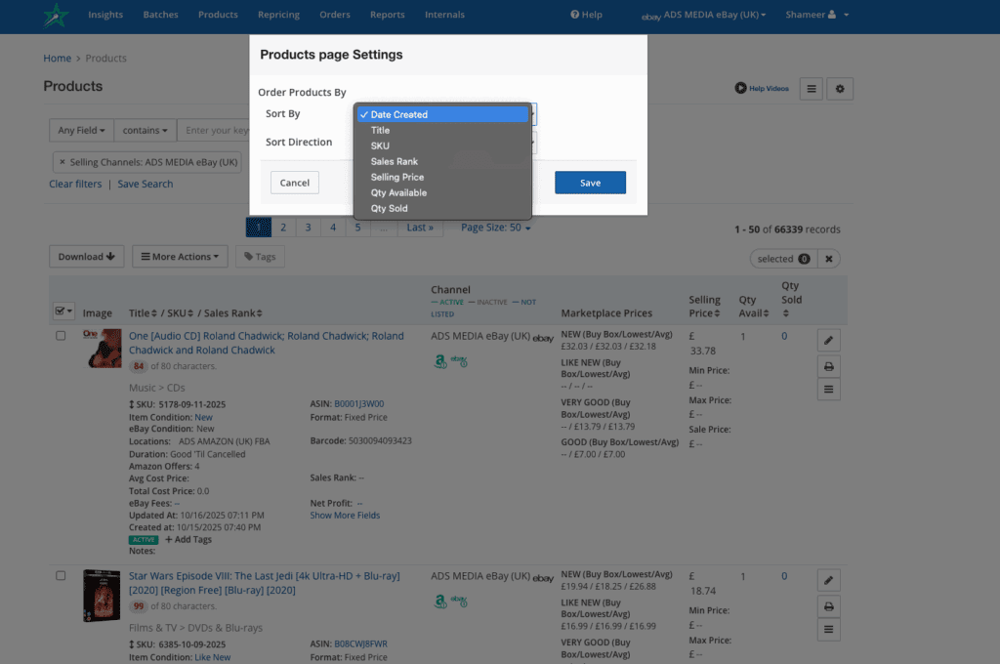
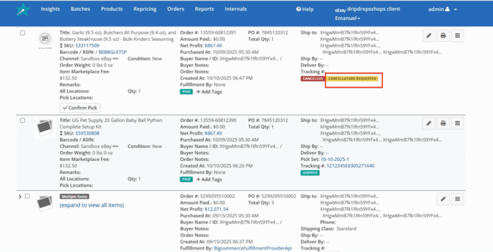
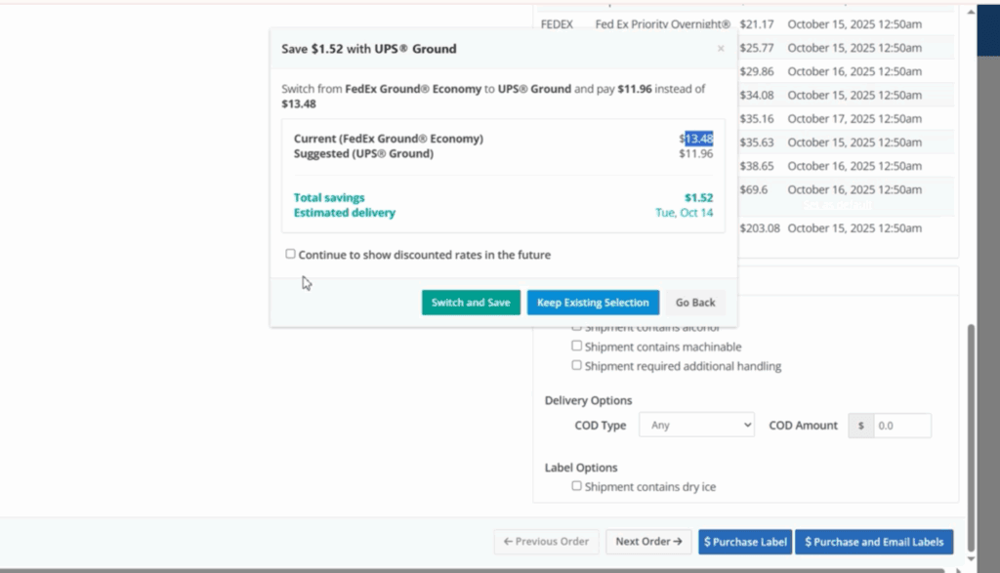

 We’ve added a bunch of useful improvements this month to help you work faster, stay organized, and save more time on everyday tasks. Everything below is designed to remove extra steps and make your workflow smoother. Let’s take a look at what’s new

<h2>1. Cleaner Batch View With Status Labels in the Header
</h2>

 We improved the batch page so you can understand your listing progress more quickly.

<h3>What's New:
</h3>

All status labels, such as Submitted, Not Submitted, Active, and Inactive, are now displayed at the top of the table. You will still see the color-coded counts under each batch, but without the repeated labels on every row.

<h3>Why It Matters:
</h3>

The batch view now looks clean and organized. It is easier to read, and you can check the status of every batch in seconds without looking through extra information.

<h2>2. Download Orders Report by Date Range for Listings in a Batch
</h2>

 You now have a simple way to track how a batch performed during any time period.

<h3>What's New:
</h3>

Inside any batch, you can download an Orders Report for the date range you choose. This report includes all orders related to that batch’s listings.

<h3>Why It Matters:
</h3>

This helps you review sales, compare performance in different time periods, and easily share accurate reports with your team. It also makes reconciliation smoother.

<h2>3. New Sorting Options on the Products Page
</h2>

 Managing your product catalog is now more flexible and easier to control.

<h3>What's New:
</h3>

You can sort products by Date Created, Title, SKU, Sales Rank, Selling Price, Quantity Available, or Quantity Sold. Use the gear icon on the Products page to pick your sort preferences and save them.

<h3>Why It Matters:
</h3>

You can find items faster and keep your workspace more organized. This is especially helpful if you manage a large number of products.

<h2>4. eBay Cancellation Requests Now Visible in SellerChamp
</h2>

 We added a simple way to stay informed about buyer cancellation requests.

<h3>What's New:
</h3>

When a buyer requests a cancellation on eBay, you will now see a clear Cancellation Requested badge inside SellerChamp for that order.

<h3>Why It Matters:
</h3>

You can respond quickly, avoid shipping items by mistake, and provide better customer service.

<h2>5. Smarter Shipping Suggestions and Warnings
</h2>

 You now have guidance that helps you save money on shipping labels.

<h3>What's New:
</h3>

SellerChamp will notify you if you pick a shipping service that costs more than a similar option from another carrier. The system shows the cheaper suggestion and also shows how much you can save. You can choose Switch and Save or Keep Existing Service.

<h3>Why It Matters:
</h3>

You can prevent overspending on labels and lower your overall shipping costs without changing your workflow.

<h2>6. Smarter Item Specifics Mapping from Amazon to eBay
</h2>

We improved how product details move from Amazon to eBay so you spend less time fixing listings.

<h3>What's New:
</h3>

SellerChamp now checks both platforms and maps item specifics only when the names match, and the selected eBay category allows them. If a field is not supported on eBay, it will not be added. You will only get clean, valid specifics.

<h3>Why It Matters:
</h3>

This reduces errors and extra work. Your listings stay accurate, you avoid rejected specifics on eBay and you save time that would usually be spent deleting or correcting fields. It helps you publish listings faster with fewer issues.

<h2>7. Bulk File Uploads Are Now 10x Faster
</h2>

We upgraded bulk processing to make large updates smoother and much quicker for your team.

<h3>What's New:
</h3>

Bulk file uploads for pricing updates, inventory adjustments, and large SKU changes now finish up to ten times faster. Even very large files are processed quickly in the background.

<h3>Why It Matters:
</h3>

You get your updates done in a fraction of the time. This means less waiting, fewer workflow delays, and more time to focus on tasks that drive sales. It also helps teams that manage big catalogs stay efficient during busy periods.

<h2>That’s a wrap for October
</h2>

This month, we focused on making your work faster, smarter, and more organized. You now have cleaner batch views, easier sorting, smarter item mapping from Amazon to eBay, helpful shipping suggestions, and bulk uploads that are up to 10× faster. We hope these updates save you time and make managing your listings simpler. As always, if you have ideas or need support, our team is here to help.

See you next month <strong>The SellerChamp Team</strong>

{{ site.app.leads }}?utm_source=blog&utm_campaign=sellerchamp-october-2025-product-updates


Schedule a demo today and discover how our Bulk Lister can help you list more products, increase sales, and grow your e-commerce business faster than ever.

