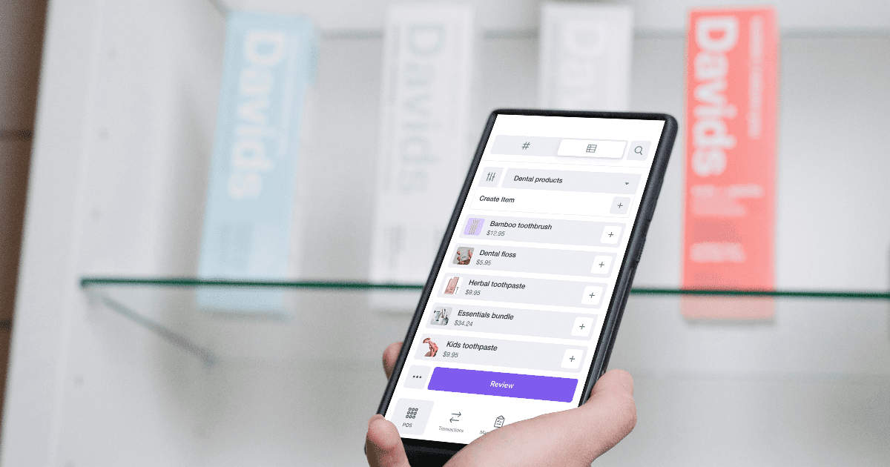

 <b>Managing inventory on Etsy</b> can quickly become overwhelming as your shop grows. Without the <b> right systems</b>, even high-performing listings can lead to cancelled orders, unhappy buyers, and avoidable revenue loss. In this guide, we walk you through <b>proven </b><b>inventory management practices for Etsy</b> to help you stay in control, prevent overselling, and scale fast.

<strong>You might also like:</strong><a href="/blog/how-to-get-sales-on-etsy/"><b>How to Get Sales on Etsy? Proven Tips, Tricks, and Strategies</b></a><b>
</b>

{{ site.app.leads }}?utm_source=blog&utm_campaign=etsy-inventory-management


<h2>Why Overselling Is a Big Deal:
</h2>

 Overselling or <b>promising an item you can’t deliver</b> is severely detrimental to your shop’s reputation. Inventory mismatches lead to cancelled orders and bad reviews. Around <b>91% of customers </b> don’t wait for a<a href="https://www.toolsgroup.com/blog/the-hidden-costs-of-poor-inventory-management-how-much-are-you-really-losing/#:~:text=retail%20sales.%20,negative%20experience%20like%20a%20stockout"> restock after a stockout</a>, and <b> 69% </b> immediately <a href="https://www.opensend.com/post/inventory-stock-out-rate-statistics">go for competitors.</a> In short, every stock issue results in lost sales and unhappy buyers.

<ol>
<li><b>Trust and sales:</b> Global retail loses millions of customers and 8.3% of annual sales to stockouts.</li>
<li><b>Competitive pressure:</b> Nearly all customers switch to direct competitors if their first item in a store is sold out.</li>
<li><b>Extra costs:</b> Scrambling to restock can mean rushed shipping or lost discounts. Efficient planning lets you avoid these hidden costs.</li>
</ol>

<strong>Check out:</strong><a href="/blog/etsy-inventory-management-software/"><b>Best Etsy Inventory Management Software for Growing Sellers </b></a>

<h2>Centralize Inventory in One System:
</h2>

 Avoid juggling spreadsheets or multiple channel reports. Instead, use <b>one platform as your source of information</b>. This is critical if you sell on Etsy as well as on other channels. Sync delays or manual updates are the top <b> culprits of overselling. </b><a href="/inventory-sync-software/">A solution like SellerChamp</a> centralizes all your listings, so a sale on Etsy instantly syncs across your other channels. This <b> single dashboard approach</b> means you only update stock once and let the system handle the rest.

<ol>
<li><b>One inventory “brain”:</b> Store all SKUs and stock levels in one place.</li>
<li><b>Consistent SKUs:</b> Use the same SKU or SKU mapping across channels. Mismatched SKUs lead to errors like double-selling an item when the system can’t match up listings.</li>
<li><b>Real automation:</b> Software can automatically re-sync stock every few seconds or minutes. This is a must-have; humans can’t click fast enough when demand surges.</li>
</ol>
<b>Explore: </b><a href="/blog/etsy-marketing-done-right-the-comprehensive-guide-for-more-sales/"><b>Etsy marketing done right – The comprehensive guide for more sales </b></a>

<h2>Sync Stock In Real Time After Every Sale:
</h2>

 The #1 rule is that your inventory updates instantly with every sale. Even a <b>one-second delay </b> can cause a double sale during a big promotion. <b>Real-time syncing</b> means that when you sell 1 unit, 1 unit is removed from every listing. This prevents “ <b>sorry, sold out</b> ” emails before they happen. Most sellers need a tool for this because Etsy’s native system adjusts inventory only after a sale and doesn’t provide proactive alerts.

<ol>
<li><b>Turn on auto-sync:</b> Use tools that connect directly to Etsy’s API. Once active, they pull sales as they happen. For example, <a href="/inventory-sync-software/">SellerChamp’s inventory sync tool</a> updates stock everywhere (for all variants, as defined, and on all channels) with each sale.</li>
<li><b>Check connections:</b> Make sure your listing software stays connected. If a channel disconnects, the sync can fail. Regularly verify integrations.</li>
</ol>

<strong>You might also like:</strong><a href="/blog/best-ecommerce-automation-platform-tools-2025/"><b>Best Rated E-Commerce Automation Platforms and Tools [Updated]</b></a><b>
</b>

<h2>Plan Ahead With Alerts And Stock Buffers:
</h2>

 Never let your stock run to zero without knowing it. <b>Set reorder points</b> and <b>maintain a buffer</b>. For example, keep at least a few extra items (“safety stock”) of your fast-selling products. That way, even if there’s a brief surge in demand or a supplier delay, you won’t immediately stock out.

<ol>
<li><b>Set reorder alerts:</b> Choose a quantity (e.g., 5 items left) and the system notifies you.</li>
<li><b>Safety buffer:</b> If a product usually sells 5x a week (you’ll be tracking this with your third-party tool), keeping 3 extras can cover you if orders suddenly spike. This small buffer can avoid big problems.</li>
<li><b>Regular counts:</b> Even with automation, inventory audits catch rare issues. Cycle count sections of your inventory (especially high-volume items) to confirm counts match reality.</li>
</ol>

<strong>Check out:</strong><a href="/blog/reasons-sellers-should-use-multi-channel-listing-tools/"><b>10 Game-changing Reasons Sellers Should Use Multi-Channel Listing Tools</b></a>

<h2>Use Data To Forecast And Optimize Stock:
</h2>

 Look at <b>historical sales data</b> on Etsy to spot trends (holidays, weekends, etc.). Proper forecasting helps you order enough inventory before peak seasons. According to experts, <b> planning with demand forecasts</b> is a top prevention tactic. <a href="/ecommerce-analytics-tool-insights-reports/">SellerChamp’s analytics reports</a> can show which items are selling the fastest. Use that to prioritize stock.

<ol>
<li><b>Avoid excess: </b> If a certain product is trending up, bump up its stock ahead of time. On the flip side, if something barely sells, don’t overstock. Excess inventory ties up cash. Analytics tools can flag slow-moving SKUs.</li>
<li><b>Track sales trends:</b> Use real-time inventory monitoring tools, dashboards, and historical reports to prevent stockouts and overstocking. Having a single dashboard for reports saves time and sharpens focus. </li>
</ol>
<b>Explore:</b><a href="/blog/ecommerce-process-automation-tools/"><b> E-Commerce Process Automation: How to Do It + Key Tools</b></a><b>
</b>

<h2>Handle Variants, Bundles, And Made-To-Order Listings Carefully:
</h2>

 Etsy sellers often oversell, not because of demand, but because of <b>complex listing structures.</b>
<b>Variations </b> (size, color, material), bundles, and <b>made-to-order products</b> can quickly throw inventory counts off if they aren’t tracked correctly. For example, if multiple variations pull from the same base inventory, such as different colors of the same item, each sale must <b>deduct stock from both the individual colors and the collective pool. </b> Without proper mapping, sellers may think they have stock left when it has already been sold through another variation. The same <b>risk </b> applies to bundles, where one order consumes multiple SKUs at once.

<ol>
<li><b>Structured inventory tracking: </b> Use tools that support variant-level tracking and bundle mapping to ensure every component is accounted for in real time.</li>
<li><b>Consider your custom items: </b> If you sell made-to-order items, consider tracking your raw materials’ inventory as well. Furthermore, even if products aren’t pre-stocked, production caps avoid accepting more orders than you can realistically fulfill within Etsy’s processing times.</li>
<li><b>Set clear production limits:</b> Clear limits protect your shop metrics, delivery promises, and customer satisfaction.</li>
</ol>

<strong>You might also like:</strong><a href="/blog/online-marketplaces-in-usa-for-ecommerce-sellers/"><b>Top 10 Online Marketplaces in USA for E-Commerce Sellers </b></a>

<h2>Pick The Right Tools For Etsy:
</h2>

 With multiple third-party inventory software options available, <b>choosing the right tool </b> is critical. Choose one that connects with Etsy, fits your budget, and handles variations or bundles as you use them.

<ol>
<li><b>SellerChamp integration</b>: SellerChamp connects directly to Etsy. It can bulk-edit your listings, sync stock, and even manage orders all from one place. For example, its <a href="/bulk-lister-seller-champ/">bulk lister</a> helps create uniform listings quickly, so your SKUs stay consistent across shops.</li>
<li><b>SellerChamp analytics and reports</b>: SellerChamp offers comprehensive reports detailing not just sales and profits but also spending analyses. Get centralized order and purchase tracking for efficient order management.</li>
<li><b>Stay</b>
<b>current:</b> Tools get updates as Etsy evolves. For example, Etsy may roll out new inventory features; third-party apps will adapt faster so you never miss a beat. </li>
</ol>

<h2>Frequently Asked Questions (FAQs)
</h2>

<h3>Q: Can I rely on Etsy’s built-in inventory system alone?
</h3>

Etsy’s native inventory system works for very small shops selling on a single channel. However, it lacks proactive alerts, cross-channel syncing, and advanced controls for bundles or shared inventory. As order volume increases, sellers often outgrow Etsy’s built-in tools and need third-party software for accuracy and scalability.

<h3>Q: How often should I review my inventory if I’m already using automation?
</h3>

It’s a good practice to review your inventory weekly or biweekly, especially for fast-selling items.

<h3>Q: Do digital products or downloads need inventory management?
</h3>

Digital products don’t face stockouts, but sellers offering both physical and digital items should still clearly separate tracking. Mixing fulfillment types without clear organization can cause processing errors, especially when digital add-ons or bundles are involved.

<h3>Q: What happens if I oversell occasionally? Will Etsy penalize my shop?
</h3>

While occasional overselling won’t immediately shut down your shop, repeated order cancellations or delays can negatively affect buyer trust, reviews, and overall shop performance. Over time, this can reduce repeat purchases and harm long-term growth, even if there’s no formal penalty.

<h3>Q: Is inventory software worth it for small Etsy shops?
</h3>

For sellers with low order volume, spreadsheets may work. However, inventory software becomes worth the investment once you manage multiple SKUs, variations, or channels, or when order volume makes manual updates error-prone.

<h3>Q: How do returns or exchanges affect inventory accuracy?
</h3>

Returned items should be inspected before being added back into available stock. Automatically restocking returned items without quality checks can create false inventory and lead to future fulfillment issues.

<h3>Q: What’s the biggest sign I need to upgrade my inventory system?
</h3>

If you’re frequently double-checking stock, delaying listings during busy periods, or worrying about overselling during promotions, it’s a clear signal that your current system isn’t keeping up with your growth.

<h2><a href="https://app.sellerchamp.com/leads/new">Ready to take control of your Etsy inventory? </a>
</h2>

If you are ready to scale without overselling, SellerChamp is the smartest upgrade you can make. Manage Etsy inventory, automate listings, and sync stock across marketplaces from one dashboard.

<h5>Request a SellerChamp demo
</h5>

<a style="color: #ffffff;" href="https://app.sellerchamp.com/leads/new">See how SellerChamp can automate stock updates, prevent overselling, and keep your shop running smoothly. <b>Book your free demo today and experience real-time inventory management in action.</b></a>

