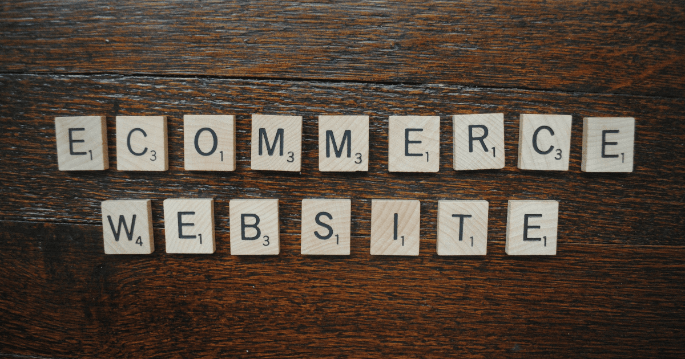

 Selling online is <b>more competitive</b> than ever before. With tech companies and platforms now regularly updating their algorithms and features, knowing <b>how to market your e-commerce website</b> is critical to survival. In this guide, you’ll learn how to <b> drive more traffic </b> to your store, convert browsers into buyers, and handle the <b>behind-the-scenes tech</b>.

<strong>You might also like:</strong><a href="/blog/top-rated-online-selling-sites-2026/"><b>25 Top-Rated Online Selling Sites in 2026</b></a><b>
</b>

{{ site.app.leads }}?utm_source=blog&utm_campaign=how-to-market-your-e-commerce-website-in-2026


<h2>Optimize Your SEO and Content
</h2>

 Even today about <b>53% of all website visits </b><a href="/blog/ecommerce-branding-strategies/#:~:text=Did%20You%20Know%3A%20According%20to,traffic%20comes%20from%20organic%20search"><b>come from organic search</b></a> showing how search engines still rule e-commerce traffic. In 2026, SEO is becoming more AI-based, conversational, and structured.

<h3>Target relevant keywords:
</h3>

<ul><li>Include your <b>main keyword</b> in the page title, subheads, and URL.</li><li>Target <a href="https://www.semrush.com/blog/how-to-choose-long-tail-keywords/">long-tail keywords </a>and be specific about what you’re selling and the audience you want to attract to <b> generate higher-quality leads</b>.</li><li>For example, if you sell coffee gear, optimize for queries like “best coffee maker 2026.” Higher rankings mean more free visitors. </li>
</ul>

<h3>Optimize visuals (images, videos) & voice search:
</h3>

<ul><li>Include your <b>main keyword</b> in the page title, subheads, and URL.</li><li>Target <a href="https://www.semrush.com/blog/how-to-choose-long-tail-keywords/">long-tail keywords </a>and be specific about what you’re selling and the audience you want to attract to <b> generate higher-quality leads</b>.</li><li>For example, if you sell coffee gear, optimize for queries like “best coffee maker 2026.” Higher rankings mean more free visitors. </li>
</ul>

<h3>Speed up your site:
</h3>

<ul><li>When even a one-second delay in page loading time can <b>cost you ~7% of conversions</b>, minimizing time becomes critical.</li><li><b>Mobile-first browsing</b> also demands speed. Over 70% of shoppers today browse on phones.</li><li>Use tools like Google PageSpeed Insights to discover your slow elements and fix them. Fast, mobile-friendly sites rank higher and convert better.</li>
</ul>

<strong>Check out:</strong><a href="/ecommerce-seo-checklist/"><b> E-COMMERCE SEO CHECKLIST </b></a>

<h2>Harness Social Media & Influencer Buzz
</h2>

 Social platforms are where your customers hang out. <b>73% of marketers say social media is effective for driving business results</b>.

<h3>Optimize your social media:
</h3>

<ul><li>Create a regular <b> posting schedule</b> with engaging content: short videos (TikTok/Instagram Reels), live demos, and shoppable posts that let customers buy without leaving the app. For example, set up <a href="https://help.instagram.com/2022466637835789">Instagram Shopping tags </a>or a Facebook Shop, so users can click products in your posts.</li><li>Ensure your products and posts are shareable. </li>
</ul>

<h3>Run targeted social ads:
</h3>

<ul><li>Use Facebook/Instagram and TikTok ads to <b> reach buyers by interest </b> or behavior. Promoted posts and stories can drive traffic during peak times (holidays, weekends). </li>
</ul>

<h3>Leverage influencers:
</h3>

<ul><li>Partner with niche influencers whose followers match your customers. Influencer campaigns pay off, and brands can generate about <b>$6.50 in revenue for every $1 spent</b> on <a href="https://influencermarketinghub.com/influencer-marketing">influencer marketing.</a></li><li>Authentic reviews and unboxing videos build trust and bring immediate traffic.</li>
</ul>

<h3>Use user-generated content:
</h3>

<ul><li>Encourage customers to post <b>reviews or photos</b> using your products. This <a href="https://www.shopify.com/blog/social-proof">social proof</a> (testimonials, tagged images) significantly <b>boosts credibility</b> as shoppers trust real users.</li><li>Repost this content on your channels to generate <b>community buzz</b>.</li>
</ul>
<b>Explore:</b><a href="/blog/how-to-sell-on-tiktok-shop/"><b> How to Sell on TikTok Shop [2025 Updated Guide] </b></a>

<h2>Leverage Email, Loyalty & Referral Programs
</h2>

 <a href="https://www.emailvendorselection.com/brick-and-mortar-store-online/#:~:text=The%20success%20of%20email%20marketing,or%20even%20earlier">Email marketing</a> remains a powerhouse, with studies estimating up to <b>3,800% ROI</b> from email campaigns.

<ol><li><b>Build an email list </b> (offer a discount or ebook to subscribe) and send targeted newsletters.</li><li><b>Segment subscribers</b> (e.g., by purchase history) to send relevant product suggestions.</li><li>Include <b>promotions and deadline-driven offers</b>. Offer limited-time coupons or Buy One, Get One deals to create urgency and clicks.</li><li>Implement your basic flows smartly:</li>
</ol>

<h3>Welcome and abandonment flows:
</h3>

<ul><li>About 68% of <a href="https://www.klaviyo.com/blog/reduce-cart-abdonment">carts get abandoned</a> online, but well-timed reminders (sometimes with a small incentive) can recover <b>~30% of those sales</b>.</li>
</ul>

<h3>Referral incentives:
</h3>

<ul><li>Create a <b>referral program</b> that rewards both the referrer and the friend (discounts, free items, points). </li><li><b>Word-of-mouth referrals </b> multiply reach without additional ad spend.</li>
</ul>

<h3>Loyalty rewards:
</h3>

<ul><li>Give <a href="https://www.zendesk.com/blog/loyalty-rewards/"><b>loyal customers </b></a>early access, exclusive discounts or loyalty points. This not only boosts repeat traffic but also encourages them to share your store with peers. </li>
</ul>
<strong>You Might Also Like: <a href="/blog/7-abandoned-cart-email-best-practices-to-win-back-customers/">7 Abandoned Cart Email Best Practices to Win Back Customers </a></strong>

<h2>Expand to Marketplaces & Social Commerce
</h2>

 Don’t rely on your website alone. Today’s shoppers hop across platforms. Roughly <b>37% of consumers start on marketplaces</b> (like Amazon or eBay), and about <b>95% compare </b><a href="/blog/sell-on-multiple-marketplaces/#:~:text=timeframe%20to%20hit%20that%20point,search%20engines%20and%20brand%20websites"><b>multiple channels</b></a> before buying. Use tools to <b>simplify this overwhelming process</b>. For example,<a href="/bulk-lister-seller-champ/"> SellerChamp’s Bulk Lister </a>lets you list thousands of products across channels in minutes, while <a href="/multi-channel-fulfillment-software/">Multi-Channel Fulfillment </a>connects to shipping platforms.

<h3>List on key marketplaces:
</h3>

<ul><li>Publish your catalog on sites like Amazon, <a href="/blog/automate-ebay-listings/">eBay</a>, Walmart, and Etsy. Each new channel <b> taps a different audience. </b>
</li><li>If you fear inventory chaos, rely on <b>multi-channel software </b> to <a href="/blog/product-listing-optimization/">push listings everywhere at once.</a></li>
</ul>

<h3>Sync inventory instantly:
</h3>

<ul><li>With multiple sales platforms, <b>stock management</b> becomes critical.</li><li>Systems like SellerChamp automatically update quantities on all platforms. So, when one item sells, the stock count instantly drops everywhere. </li><li>This <a href="/inventory-sync-software/"><b>real-time sync</b></a><b> prevents overselling</b> and avoids disappointed shoppers and negative feedback.</li>
</ul>

<h3>Enable social shopping:
</h3>

<ul><li>Platforms like Instagram, Pinterest, and TikTok have shops/ <b>extended shopping features</b>. Tag products in your posts or run <a href="https://www.publicissapient.com/insights/4-ways-livestream-shopping-is-taking-e-commerce-to-the-next-level">live-stream shopping events.</a> This way, a casual scroll can turn into a purchase without an extra click.</li><li>Engaging directly where users spend hours boosts conversions.</li>
</ul>

<strong>Check out:</strong><a href="/blog/multi-channel-ecommerce-guide/"><b>Comprehensive Guide to Multi-Channel Ecommerce + Tools and Tips </b></a>

<h2>Streamline Fulfillment & Operations
</h2>

 E-commerce marketing fails if <a href="/blog/ecommerce-fulfillment-services-guide-best-options/">fulfillment</a> lags. Fast, reliable shipping is part of your brand promise.

<h3>Centralize orders:
</h3>

<ul><li>Manage all orders in one interface. Use a <a href="/multi-channel-fulfillment-software/">tool like SellerChamp</a> to see order volume and shipment status at a glance, <b>boosting efficiency and speed.</b></li><li>SellerChamp also consolidates features like <b>label printing </b> to free you from manual processing. </li>
</ul>

<h3>Optimize inventory & pricing:
</h3>

<ul><li><b>Use data to set prices and stock levels</b>. <a href="/ecommerce-analytics-tool-insights-reports/">SellerChamp’s insights</a> show which products move fastest and where. You might find that certain items sell better on one channel, and you can use that insight to <b> tweak promotions</b>.</li><li>By <a href="/blog/repricing-strategies-ecommerce-profitability/"><b>dynamically adjusting prices</b></a> (check out <a href="/repricer-software/">SellerChamp’s RePricer</a>), you stay competitive without constant manual checks.</li>
</ul>

<h3>Analyze sales data:
</h3>

<ul><li>Track sales and profit by channel. Sellers using optimized multi-channel listings (with SellerChamp) report up to a <b>7.8× increase in conversions.</b> Use your reports to double down on the best-selling products/channels and <b>cut spend on underperformers</b>.</li>
</ul>
<b>Explore: </b><a href="/blog/what-is-multi-channel-fulfillment-and-how-does-it-work/"><b>What is Multi-Channel Fulfillment and How Does it Work?</b></a>

<h2>Adapt to Platform & Market Changes
</h2>

 E-commerce platforms are evolving fast, and long-term growth now depends on <b>technical readiness</b> as much as marketing creativity.

<h3>Embrace AI tools:
</h3>

<ul><li>AI is now part of marketing. <a href="/blog/ai-tools-for-e-commerce/">Use AI</a> to write <a href="/blog/writing-the-perfect-product-listing-key-elements-to-drive-sales/">product descriptions</a> or generate ad copy faster (saving time and improving SEO with fresh content).</li><li>Implement AI chatbots on your site to <b> answer customer questions instantly,</b> improving user experience and conversion rates. <b> Conversational AI</b> will soon be the norm for customer support.</li>
</ul>

<h3>Watch consumer trends:
</h3>

<ul><li><b>Be ready for trends and shifts</b> like shorter attention spans or new social platforms. For example, if live video shopping (live streams) is hot in 2026, consider doing live demos.</li><li><b>Monitor data</b> (Shopify notes e-commerce remains a $6.9T global market and social commerce is nearing $1T), and be willing to test new channels and formats as they emerge.</li>
</ul>

<h2>Frequently Asked Questions (FAQs)
</h2>

<h3>Q: What new trends in 2026 should I use in my marketing?
</h3>

Personalization and AI are big trends. Tailor emails and recommendations to each customer and make maximum use of AI features. Additionally, short-form videos and live shopping events are getting increasingly popular. Keep an eye on the trends and data.

<h3>Q: Is it better to invest in marketplace marketing or direct-to-consumer (DTC) growth?
</h3>

Marketplaces offer built-in demand, faster customer acquisition, and higher initial visibility, whereas DTC channels give you full control over branding, customer data, and margins. Successful sellers use marketplaces to generate cash flow and demand, while investing in DTC to build customer loyalty.

<h3>Q: How can e-commerce sellers use data analytics to improve marketing decisions?
</h3>

Data analytics helps sellers understand what’s actually driving sales, not just traffic. By analyzing metrics such as conversion rates, channel-wise ROI, inventory turnover, and customer lifetime value, sellers can allocate marketing budgets more effectively.

<h3>Q: What common marketing mistakes should new marketplace sellers avoid in 2026?
</h3>

New sellers often rely too heavily on ads without optimizing listings, ignore inventory accuracy across channels, or fail to comply with updated policies or platform technical requirements. Other common mistakes include inconsistent pricing, poor product content, and neglecting customer reviews. In 2026, sustainable growth comes from combining strong listings, automation, compliance, and data-driven marketing rather than short-term tactics alone.

<h3>Q: How do changes in marketplace policies affect long-term e-commerce growth strategies?
</h3>

Marketplace policy changes directly influence visibility, operational stability, and scalability. These can determine whether a seller can grow smoothly or face disruptions. Sellers who plan for policy shifts by using compliant, adaptable tools and diversifying across multiple channels are better positioned for long-term growth.

<h2><a href="https://app.sellerchamp.com/leads/new">Automate your listings, inventory, and orders for a successful e-commerce store. Schedule a live demo today.</a>
</h2>

<h5>Request a SellerChamp demo
</h5>

Stop struggling with manual listings and errors. <a style="color: #ffffff;" href="https://app.sellerchamp.com/users/sign_up?_gl=1*ffe1mt*_gcl_au*NzkwNDgxMTY2LjE3NjIxOTgwOTY.*_ga*MTc1MDE5MTE4MS4xNzM3MDY4MTgx*_ga_F2WQV1CVLC*czE3Njg2MDcyNzAkbzkxJGcwJHQxNzY4NjA3MjcwJGo2MCRsMCRoMTY5MTcyNjYxMg..&_ga=2.79300884.1829544004.1768607271-1750191181.1737068181"><b>Request a SellerChamp demo</b></a> today and see how easy managing your eBay store can be.

