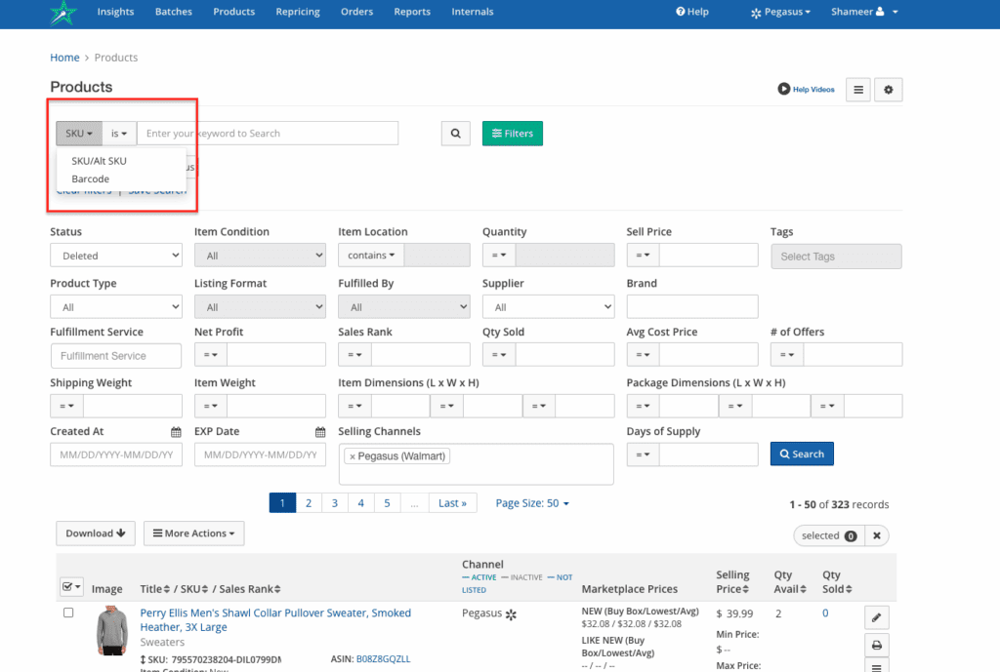
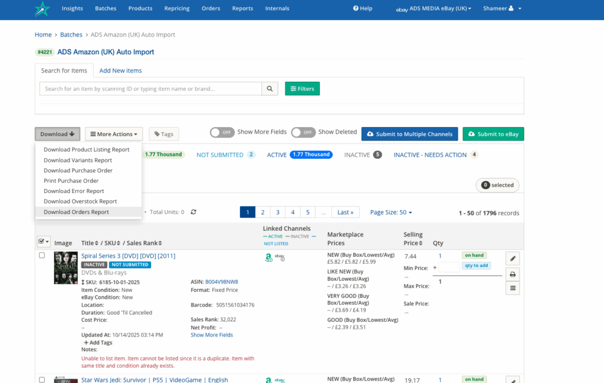
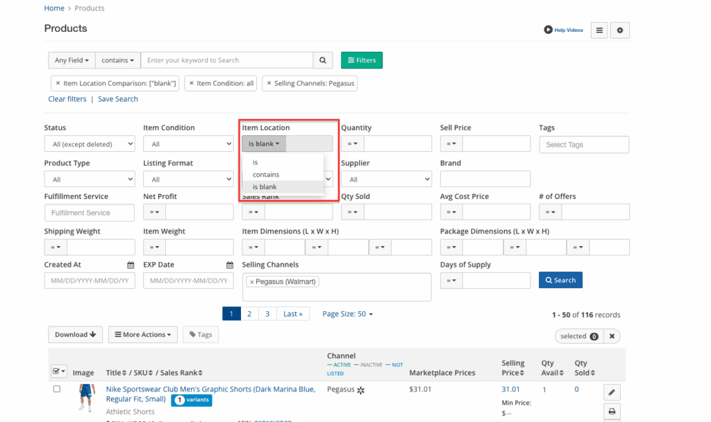
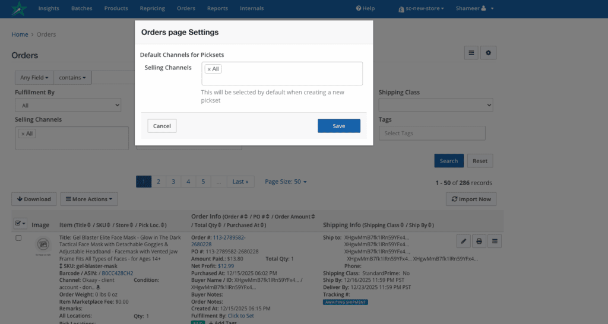
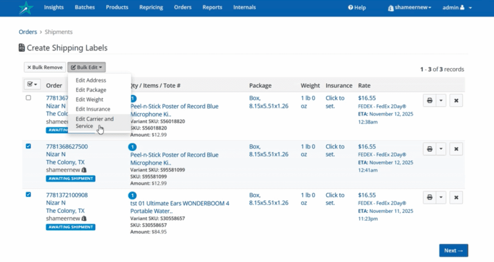

 November’s updates are all about making your daily work easier. We’ve added small but helpful improvements that save time, reduce manual effort, and help you manage products, orders, listings, and shipping more smoothly. Here’s what’s new this month and why it matters.

<h2>Find Deleted Products Faster with UPC Search
</h2>

 Finding deleted products is often needed when reviewing old listings, fixing listing issues, or checking historical data. Earlier, searches for deleted products were limited and not always flexible.

<h3>What's New:
</h3>

You can now search deleted products using <b>UPC</b> directly from the Products page, in addition to SKU. This gives you another reliable way to locate deleted listings without switching screens or exporting data.

<h3>Why It Matters:
</h3>

This update saves time when tracking down older products, validating details, or resolving listing problems. You get faster access to the information you need with fewer steps.

<h2>Easily Find Products with Missing Locations
</h2>

 Products without assigned locations can slow down picking, packing, and inventory management, especially when order volume increases.

<h3>What's New:
</h3>

SellerChamp now allows you to search and filter products with <b>blank locations</b> directly from the Products page. This makes it easy to identify items that need location updates.

<h3>Why It Matters:
</h3>

By quickly finding and fixing missing locations, you can avoid fulfillment delays and keep warehouse operations organized and efficient.

<h2>AI-Powered Description Shortening for Marketplace Listings
</h2>

 Marketplace character limits often force sellers to manually edit long product descriptions, which can be time-consuming and inconsistent.

<h3>What's New:
</h3>

SellerChamp can now automatically shorten product descriptions using AI when they exceed marketplace limits. The AI keeps the original meaning and preserves HTML formatting. You can enable this feature using <b>“Shorten via AI”</b> in your marketplace settings. <i>Note: This feature is available with AI Add-Ons. Contact support for access.</i>

<h3>Why It Matters:
</h3>

This reduces manual editing and helps ensure your listings remain compliant across marketplaces while maintaining a clean, professional look.

<h2>Set Default Channels During Pickset Creation
</h2>

 Selecting the same channels every time you create a pickset adds unnecessary repetition to order processing.

<h3>What's New:
</h3>

You can now set <b>default sales channels</b> during pickset creation on the Orders page. Once saved, these channels are automatically selected whenever you create a new pickset.

<h3>Why It Matters:
</h3>

This speeds up pickset creation, reduces repetitive clicks, and helps ensure orders are processed consistently.

<h2>Bulk Assign Shipping Service by Carrier
</h2>

 Managing shipping services one order at a time can slow down fulfillment during busy periods.

<h3>What's New:
</h3>

You can now assign shipping services in bulk. After selecting a carrier such as UPS, FedEx, or USPS, SellerChamp displays only the shipping services available for that carrier and automatically updates the rate fields.

<h3>Why It Matters:
</h3>

This makes shipping setup faster, more accurate, and easier to manage at scale, especially for high-volume sellers.

<h2>Smarter Item Specifics Mapping from Amazon to eBay
</h2>

Copying listings between Amazon and eBay can create extra or invalid item specifics if not mapped correctly.

<h3>What's New:
</h3>

SellerChamp now automatically maps item specifics from Amazon to eBay only when they already exist in the selected eBay category. Unsupported or unnecessary specifics are not created.

<h3>Why It Matters:
</h3>

This results in cleaner eBay listings, fewer listing errors, and better compliance with eBay category requirements. <b>Did You Know? More Selling Channels Are Now Supported</b>   SellerChamp continues to expand marketplace support to help sellers reach more buyers. Newly supported channels include:

<ul>
<li>Temu</li>
<li>BestBuy</li>
<li>Macy’s</li>
<li>Newegg</li>
</ul>

Our support team is available if you need help connecting to any of these platforms.

<h2>Wrapping Up November
</h2>

These November updates focus on improving speed, accuracy, and ease of use across SellerChamp. We’ll continue rolling out enhancements based on your feedback, with more improvements coming soon.

See you next month <strong>The SellerChamp Team</strong>

{{ site.app.leads }}?utm_source=blog&utm_campaign=sellerchamp-november-2025-product-updates


Schedule a demo today and discover how our Bulk Lister can help you list more products, increase sales, and grow your e-commerce business faster than ever.

