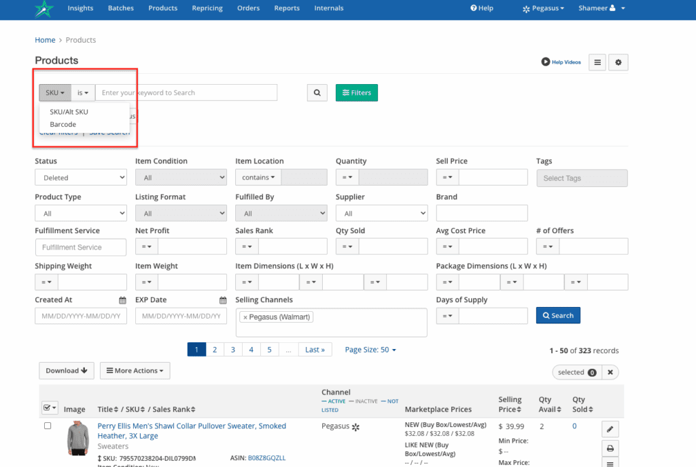
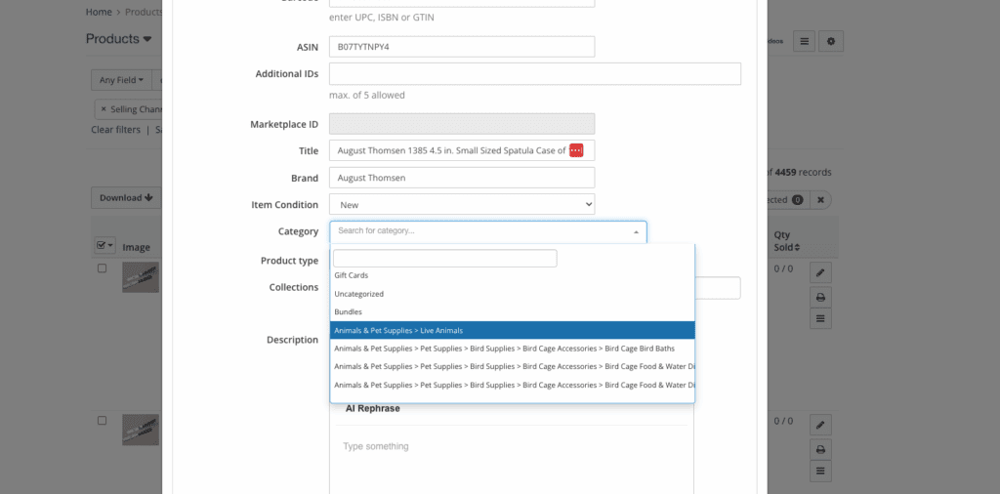
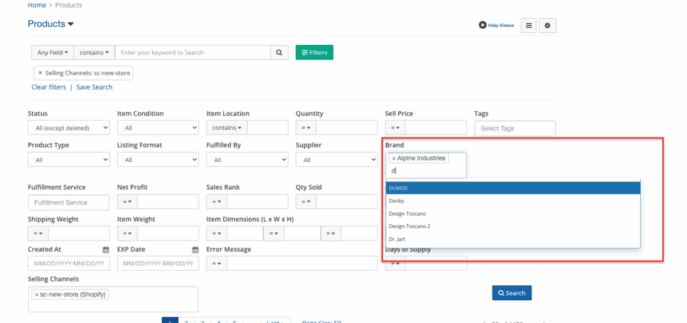
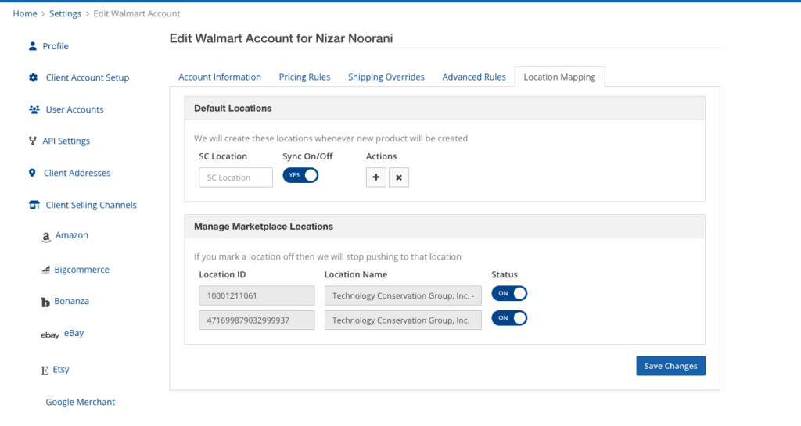
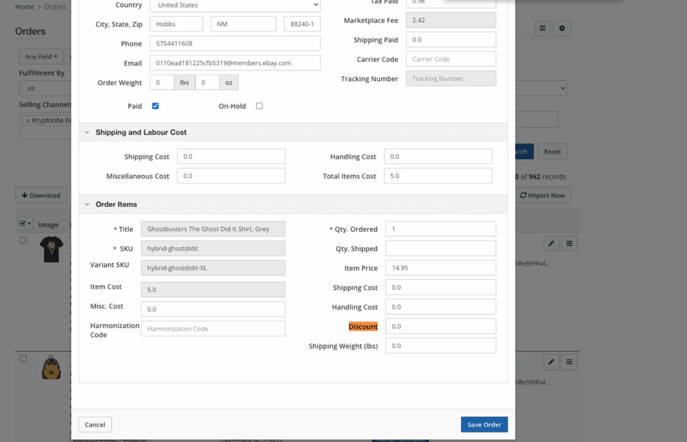
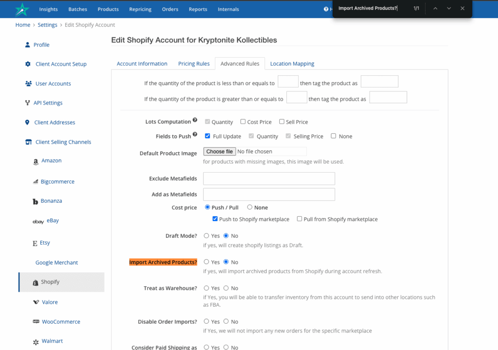

 January brings a fresh start and some exciting updates to SellerChamp. This month, we focused on improving workflows, making marketplace connections smoother, and adding features based on your feedback. These updates are designed to save you time, reduce manual work, and make managing your listings easier. Here’s what’s new this month and why it matters.

<h2>Find Deleted Products Faster with UPC Search
</h2>

 Sometimes you need to find deleted products when reviewing old listings or fixing issues. Earlier, searches on the Products page were limited to SKU only.

<h3>What's New:
</h3>

You can now search deleted products using UPC in addition to SKU directly on the Products page.

<h3>Why It Matters:
</h3>

This makes it faster and easier to locate past listings, validate data, and fix issues without extra steps.

<h2>Shopify Categories & Metafields Support
</h2>

 Keeping your Shopify listings organized is key for smooth catalog management.

<h3>What's New:
</h3>

SellerChamp now supports Shopify categories and metafields, so your catalog stays clean and matches your Shopify store perfectly.

<h3>Why It Matters:
</h3>

This keeps your listings organized and easier to manage, helping you maintain accurate product data.

<h2>Multi-Brand Search on the Products Page
</h2>

 Filtering products one brand at a time can take a lot of time for large catalogs.

<h3>What's New:
</h3>

You can now filter products by multiple brands at once on the Products page.

<h3>Why It Matters:
</h3>

This saves time and makes it easier to manage large inventories, bulk edits, and reporting.

<h2>Walmart Locations Sync Now Smoother
</h2>

 Managing inventory across multiple Walmart locations can be tricky without smooth syncing.

<h3>What's New:
</h3>

Walmart locations now sync directly into SellerChamp via the Single Node API. There’s also a dedicated settings page to manage these locations easily.

<h3>Why It Matters:
</h3>

You get better visibility and control of your inventory, making setup and maintenance faster and more reliable.

<h2>eBay Coupon Discounts on Orders
</h2>

 Coupon discounts can sometimes make revenue tracking unclear.

<h3>What's New:
</h3>

A Discount field now appears on order items when buyers use eBay coupons.

<h3>Why It Matters:
</h3>

This makes order reconciliation and reporting clearer, so you can see your real revenue more easily.

<h2>Shopify Archived Products Support
</h2>

 Archived products may still be important, but were harder to track or include before.

<h3>What's New:
</h3>

You can now optionally import archived Shopify products during refresh and filter products by Archived status.

<h3>Why It Matters:
</h3>

This gives you more control over your catalog, helps review older products, and makes it easier to relist items if needed.

<b>Did You Know? More Selling Channels Are Now Supported</b>

Reaching more marketplaces helps grow your business without extra work

<b>SellerChamp now supports Temu, Best Buy, Macy’s, and Newegg.</b>

You can manage more channels from one dashboard, sync inventory, and expand sales opportunities easily.

<h2>Wrapping Up January
</h2>

These January updates are all about improving speed, efficiency, and control in SellerChamp. From faster product search to smoother marketplace connections and new channel support, our goal is to save you time and help your business grow.

See you next month <strong>The SellerChamp Team</strong>

{{ site.app.leads }}?utm_source=blog&utm_campaign=sellerchamp-january-2026-product-updates


Schedule a demo today and discover how our Bulk Lister can help you list more products, increase sales, and grow your e-commerce business faster than ever.

