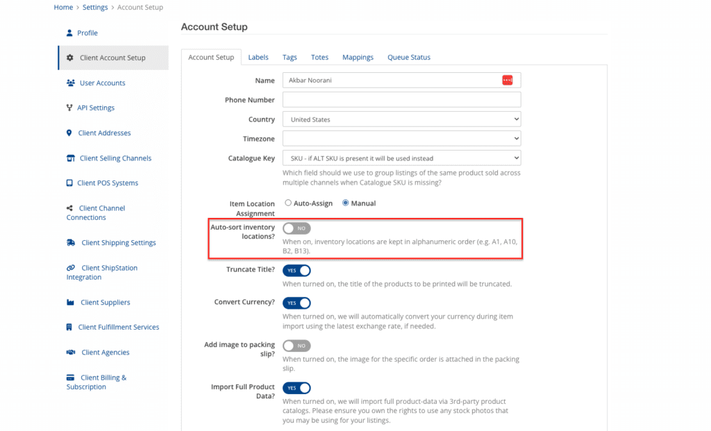
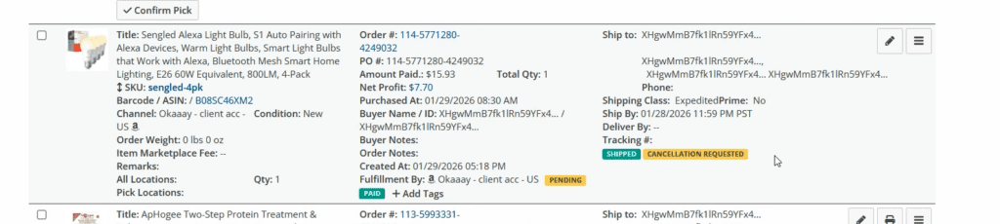
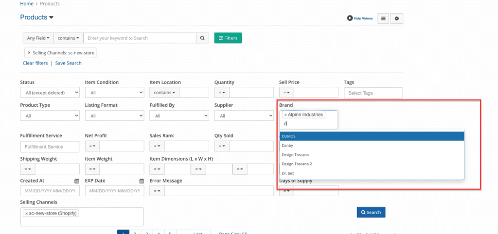
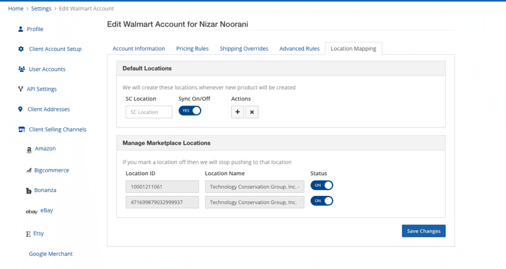
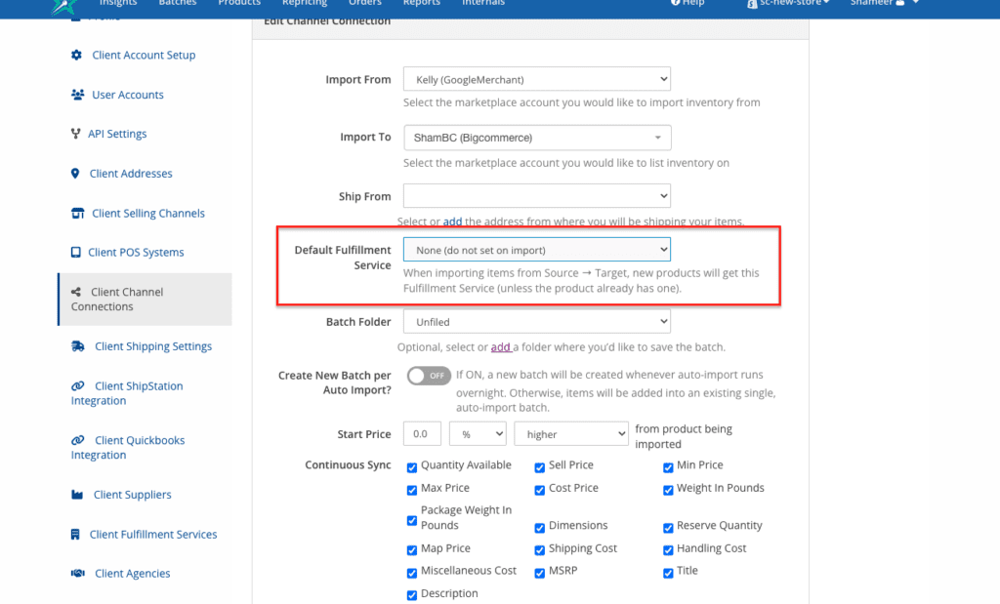
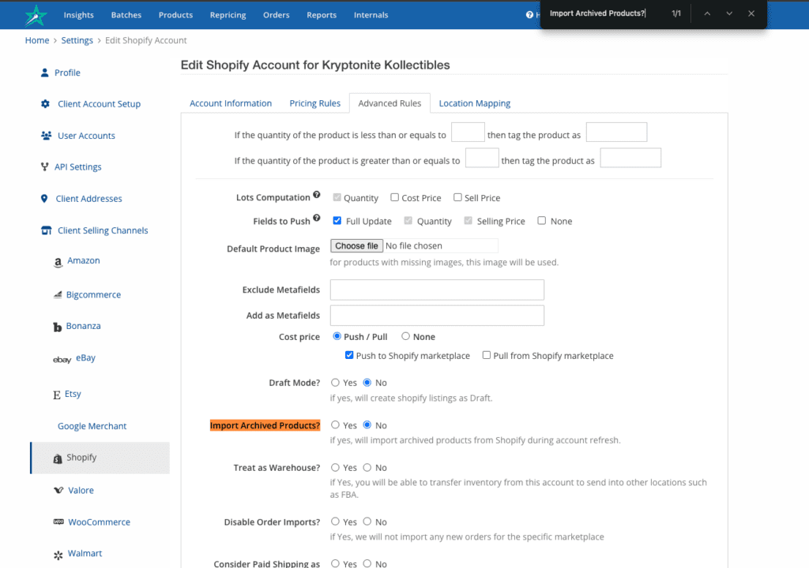

 February was all about making your daily workflow faster, smoother, and more reliable. Every improvement this month focuses on saving time, reducing errors, and helping you scale without adding complexity. Here’s what’s new.

<h2>Auto-Sorted Inventory Locations
</h2>

 Managing multiple warehouse locations can get messy as inventory shifts. This update makes picking easier and more structured for your team.

<h3>What's New:
</h3>

SellerChamp now automatically sorts multiple inventory locations into the most efficient pick sequence. Once enabled in settings, locations are arranged alpha-numerically.

Example:  A1, A10, A2, B1, B03, B12

Will automatically sort to:  A1 → A2 → A10 → B1 → B03 → B12

No manual reordering needed.

<h3>Why It Matters:
</h3>

Your warehouse team saves time on every pick. No confusion. No manual updates when stock shifts. Just a clean, logical picking flow that reduces errors and improves speed.

<h2>Amazon Cancellation Requested Flag
</h2>

 Order accuracy is critical, especially when cancellations happen after checkout. This update gives you better visibility before items ship.

<h3>What's New:
</h3>

When an Amazon buyer submits a cancellation request, a clear “Cancellation Requested” flag now appears inside your Orders view. These orders are automatically held from fulfillment.

<h3>Why It Matters:
</h3>

You avoid shipping items that are about to be canceled. That means fewer refunds, fewer disputes, and better account health. Your Amazon workflow now aligns with the seamless protection you already have for eBay.

<h2>Multi-Brand Search on Products Page
</h2>

 Large catalogs require faster filtering. Switching one brand at a time slows everything down.

<h3>What's New:
</h3>

You can now select and filter by multiple brands at the same time on the Products page.

<h3>Why It Matters:
</h3>

No more filtering one brand at a time. This saves hours when managing big catalogs and makes bulk edits far more efficient.

<h2>Walmart Locations Sync Upgrade
</h2>

 Accurate syncing is essential for correct stock levels across channels. This update improves how Walmart locations connect with SellerChamp.

<h3>What's New:
</h3>

SellerChamp now integrates Walmart’s Single Node API for improved location syncing. Walmart locations sync directly into SellerChamp, and a dedicated settings page lets you manage them easily.

<h3>Why It Matters:
</h3>

Inventory accuracy improves. The setup becomes simpler. You gain clearer control over Walmart stock across locations without manual workarounds.

<h2>Default Fulfillment Service Per Channel
</h2>

 Assigning fulfillment services manually can add unnecessary steps. This update simplifies the process.

<h3>What's New:
</h3>

You can now assign a default fulfillment service inside each Channel Connection. Any products imported through that connection will automatically inherit the assigned fulfillment service.

<h3>Why It Matters:
</h3>

This removes manual assignment and ensures every product routes correctly from day one. It keeps fulfillment consistent and reduces setup errors.

<h2>Shopify Archived Products Support
</h2>

 Managing seasonal or paused listings requires flexibility. This update gives you better control over archived items.

<h3>What's New:
</h3>

You can now choose to import archived Shopify products during refresh. You can also filter products by Archived status inside SellerChamp.

<h3>Why It Matters:
</h3>

You gain better catalog visibility and control. This is especially helpful for seasonal sellers or brands that frequently rotate inventory.

<b>Did You Know? SellerChamp Now Supports More Marketplaces</b>

SellerChamp now supports additional selling channels, including Temu, Best Buy, Macy’s, and Newegg.

This means you can expand into new marketplaces without switching systems. Manage listings, inventory, and orders for all these marketplaces from one centralized platform.

 February focused on refinement and smarter automation. Less manual work. More operational clarity. Stronger marketplace syncing. More updates are coming soon. Stay tuned.  
<b>—SellerChamp Product Team </b>

{{ site.app.leads }}?utm_source=blog&utm_campaign=sellerchamp-february-2026-product-updates


Schedule a demo today and discover how our Bulk Lister can help you list more products, increase sales, and grow your e-commerce business faster than ever.

