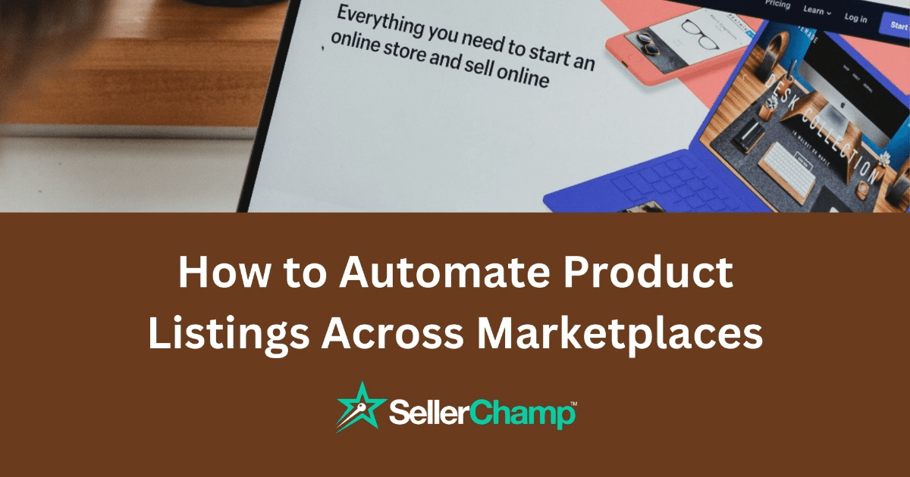

43% of online sellers <b> still </b> manage inventory manually, and it costs them <b>more than just time.</b> To avoid losses (and more), smart multi-channel sellers today <b>automate their entire product listing process</b>, from start to finish.

 In this guide, you’ll learn exactly how to model their systems and <b>automate product listings</b><b> across marketplaces</b>. Discover the <b>right tools and strategies</b> to do it efficiently, accurately, and at scale.

<strong>You might also like:</strong>
<a href="/blog/reasons-sellers-should-use-multi-channel-listing-tools/"><b>10 Game-Changing Reasons Sellers Should Use Multi-Channel Listing Tools </b></a>

{{ site.app.leads }}?utm_source=blog&utm_campaign=automate-product-listings


<h2>What Does It Actually Mean to Automate Product Listings?
</h2>

 <b>Automated product listings</b> aren’t just about bulk-uploading a spreadsheet once. Listing automation is a <b>continuous, well-connected workflow</b> that keeps your product data accurate and your inventory synced.

Here’s what a fully automated listing workflow covers:

<ul><li><b>Product data import. </b> Pull titles, descriptions, images, and item specifics from a barcode scan, CSV file, or supplier feed automatically.</li><li><b>Multi-channel publishing. </b> Push listings live across Amazon, eBay, Walmart, Shopify, and more from a single dashboard, in one action.</li><li><b>Real-time inventory sync. </b> When a product sells on one platform, stock levels update across all platforms instantly. No oversells, no manual updates.</li><li><b>Dynamic repricing. </b> Prices adjust automatically based on competitor activity and market demand. This lets you stay competitive without checking listings hourly.</li><li><b>Automated order routing. </b> Orders from each channel are routed to the appropriate fulfillment partner (FBA, 3PL, or your own warehouse) without human intervention. </li>
</ul>

<strong>Read more:</strong>
<a href="/blog/how-to-sell-on-multiple-platform/"><b>How to Sell on Multiple Platforms? E-Commerce Guide to Multi-Channel Listing</b></a>

<h2>Step 1: Build a Centralized Product Database
</h2>

 Before you can list anywhere, you need a <b>master catalog </b> where every title, description, price, SKU, and image lives.

<ul><li><b>Assign a unique SKU</b> to every product. This makes <a href="/blog/how-to-manage-ecommerce-inventory/">tracking inventory</a> and sales far easier. Inconsistent SKU structures are one of the <b>top causes of sync errors</b> in multi-channel selling.  </li><li>Use a tool like<a href="/bulk-lister-seller-champ/"> SellerChamp’s Bulk Lister</a> to <b>auto-fetch product data</b> fast and easy, eliminating hours of manual entry.  </li><li>Use AI to generate automatically optimized <b> titles and descriptions</b> tailored to each marketplace’s algorithm in seconds. According to industry data, <a href="https://www.brandxr.io/ai-powered-personalization-personalized-customer-experiences-at-scale">businesses using AI personalization</a> see around a 20% increase in average order values. </li>
</ul>

<iframe width="1342" height="355" src="https://www.youtube.com/embed/j6MpteleIpM" title="How to Fetch Product Data For Your Listings" frameborder="0" allow="accelerometer; autoplay; clipboard-write; encrypted-media; gyroscope; picture-in-picture; web-share" referrerpolicy="strict-origin-when-cross-origin" allowfullscreen></iframe>

<h2>Step 2: Choose the Right Multi-Channel Listing Software
</h2>

 Your automation and product listings are only as strong as the platform powering them.

Look for these <b> non-negotiables</b> when <a href="/blog/best-ecommerce-automation-platform-tools-2025/">selecting a platform</a> to automate your listings:

<ul><li><a href="/integrations/"><b>Broad marketplace integrations</b></a><b>. </b> Should connect to Amazon, eBay, Walmart, Shopify, Etsy, TikTok Shop, Newegg, and more (with new channels added regularly).</li><li><a href="/bulk-lister-seller-champ/"><b>Bulk listing at scale</b></a><b>. </b> Your tool should be able to list 1,000+ SKUs in minutes.</li><li><a href="/inventory-sync-software/"><b>Real-time inventory sync</b></a><b>. </b> Any sale on any platform must trigger an <b>immediate inventory update</b>.</li><li><a href="/inventory-management-api-ftp/"><b>API/FTP supplier integrations</b></a><b>. </b> For dropshippers and resellers, the ability to <b>auto-import catalogs and inventory </b> directly from suppliers is a major time-saver. </li>
</ul>

<strong>Check out:</strong>
<a href="/blog/best-ecommerce-automation-platform-tools-2025/"><b>Best Rated E-Commerce Automation Platforms and Tools [Updated]</b></a>

<h2>Step 3: Validate Your Inventory Status and Start Syncing
</h2>
<b>Without inventory synchronization</b>, every other system you build stands on shaky ground. Here’s what real-time sync looks like in practice:

<ul>
<li><b>Sell one unit on eBay? </b> Stock count drops everywhere.</li>
<li><b>Receive new stock from a supplier? </b> Available quantities update the moment the shipment is logged.</li>
<li><b>List a product as “out of stock”? </b> It gets paused or hidden until inventory is replenished.</li>
</ul>

Ensure your inventory is up-to-date and syncing systems are <b>properly configured</b> across all marketplaces.

<h2>Step 4: Tailor Listings for Each Marketplace (Without Starting From Scratch)
</h2>

 Each marketplace has its own algorithm, <a href="https://www.researchgate.net/publication/394539306_Cross-Platform_Sentiment_Comparison_Amazon_vs_eBay_vs_Walmart_Reviews">buyer psychology</a>, and formatting requirements. Automation <b>doesn’t </b> mean one-size-fits-all listings; it means making <b>channel-specific customization fast and efficient</b>. Study each platform and explore its policies to ensure your listings are tailored. Platforms <b>penalize </b> duplicate or low-quality content. Keep the messaging <b>high-quality and platform-appropriate.</b>

<strong>You might also like:</strong>
<a href="/blog/writing-the-perfect-product-listing-key-elements-to-drive-sales/"><b>Writing the Perfect Product Listing: Key Elements to Drive Sales </b></a>

<h2>Step 5: Set Up Automated Repricing to Protect Your Margins
</h2>

Prices change by the hour. Competitors adjust in real time. If you’re checking prices manually, you’re already behind. Automated repricing tools like<a href="/repricer-software/"> SellerChamp’s RePricer Software</a> monitor competitor pricing and <b>adjust listings</b>.

<ul>
<li><b>Set price floors. </b> Ensure you never sell below cost</li>
<li><b>Set price ceilings. </b> Cap prices to stay within marketplace policies and avoid pricing anomalies that hurt buyer trust.</li>
<li><b>Sales velocity repricing. </b> Increase margins when demand is high, drop prices to clear slow-moving stock.</li>
</ul>

<strong>Read more:</strong><a href="/blog/multi-channel-ecommerce-guide/">
<b>Comprehensive Guide to Multi-Channel E-Commerce</b></a>

<h2>Step 6: Streamline Order Fulfillment Across All Channels
</h2>

 Listing automation is only half the equation. Once the order comes in, your fulfillment workflow needs to be <b>just as automated,</b> or the efficiency gains disappear immediately.

<ul>
<li><b>SellerChamp’s</b><a href="/multi-channel-fulfillment-software/"> Multi-Channel Fulfillment Software</a> routes orders automatically based on SKU location, shipping zones, inventory levels, and custom business rules to suitable fulfillment destinations.</li>
<li>From centralized order management and automated shipping labels to <b> saving up to 85%</b> on shipping costs, let automation tools handle every post-sale step.</li>
<li>Afterward, you can focus on tracking performance and optimizing sales using <a href="/ecommerce-analytics-tool-insights-reports/">Insights & Reports. </a>
</li>
</ul>

<h2>What Marketplace Automation Looks Like in 2026
</h2>

Still on the fence about making the switch?

<ul>
<li><a href="https://www.hashmeta.ai/en/generative-ai/generative-ai-retail">AI in commerce</a> stands at <b>$9.8B in 2026</b>, driven by automation in product listings, catalog management, and personalization. The market is expected to grow at a <b>CAGR of 6.1% through 2034. </b></li>
<li>Automation <b> reduces manual product categorization time</b> by up to 80%, speeding up listing creation across marketplaces. </li>
<li><b>5–15% revenue lift </b> from multi-channel personalization, which is only possible when your <b>automation infrastructure</b> is solid.</li>
<li><b>73% of shoppers </b> use multiple channels before making a purchase. </li>
<li><b>80% of retail executives</b> expect to adopt AI automation across operations by 2025–2026. </li>
</ul>

<h2>Frequently Asked Questions (FAQs)
</h2>

<h3>Q: Is multi-channel listing automation only useful for large sellers with thousands of SKUs?
</h3>

Not at all. Even sellers with 50–200 SKUs benefit significantly from automation. The real value is in both speed and accuracy. Automation protects from inventory errors, pricing mistakes, and listing inconsistencies that can damage your seller ratings at any catalog size.

<h3>Q: Can I automate listings without technical skills or coding knowledge?
</h3>

Yes. Platforms like<a href="https://sellerchamp.com/"> SellerChamp</a> are built for e-commerce sellers, not developers. Connecting your channels, setting up inventory sync, and configuring fulfillment workflows can all be done through a visual dashboard. SellerChamp also offers onboarding support and live assistance to get you up and running quickly.

<h3>Q: How long does it take to get fully set up on a multi-channel automation platform?
</h3>

Most sellers can connect their channels and begin listing within 24–48 hours. More complex setups may take a few days to configure.

<h3>Q: What happens to my existing listings when I connect a new automation platform?
</h3>

A quality platform like SellerChamp imports your existing listings and maps them to a centralized catalog. The goal is to bring your current data under one managed system, not replace it.

<h3>Q: Will automating my listings hurt my SEO or search rankings on marketplaces?
</h3>

Done correctly, automation improves your rankings. When listings are complete, consistent, and enriched with platform-specific keywords and item specifics, they perform better in search results. Automation also ensures your listings stay active, which is a positive ranking signal.

<h3>Q: Can I use automation for dropshipping, not just my own inventory?
</h3>

Absolutely.<a href="/solutions/dropshipping-automation-software/"> SellerChamp’s Dropshipping Automation Software</a> lets you connect directly to suppliers via API or FTP to auto-import product catalogs and inventory in real time. Orders can be routed automatically to your supplier for fulfillment.

<h3>Q:What's the difference between cross-listing and inventory sync?
</h3>

Cross-listing is publishing one product across multiple marketplaces. Inventory sync means keeping the quantity available on each of those listings up to date. Cross-listing gets products in front of more buyers, and inventory sync makes sure you don’t oversell or disappoint them.

<h2><a href="https://app.sellerchamp.com/leads/new">Stop losing sales to overselling and messy stock tracking</a>
</h2>

<h5>Request a demo
</h5>

<a style="color: #ffffff;" href="https://app.sellerchamp.com/users/sign_up?_gl=1*bw3izc*_gcl_au*MTQ3MDcyMjA1MC4xNzcwNjkyMzYx*_ga*MTc1MDE5MTE4MS4xNzM3MDY4MTgx*_ga_F2WQV1CVLC*czE3NzA4NDk4NTEkbzk3JGcxJHQxNzcwODQ5ODc4JGozMyRsMCRoODk2NzU1MTE.&_ga=2.78517652.1434714633.1770849851-1750191181.1737068181">Request a SellerChamp demo today </a>and see how multichannel inventory syncing can help you scale faster, with fewer refunds and happier customers.

