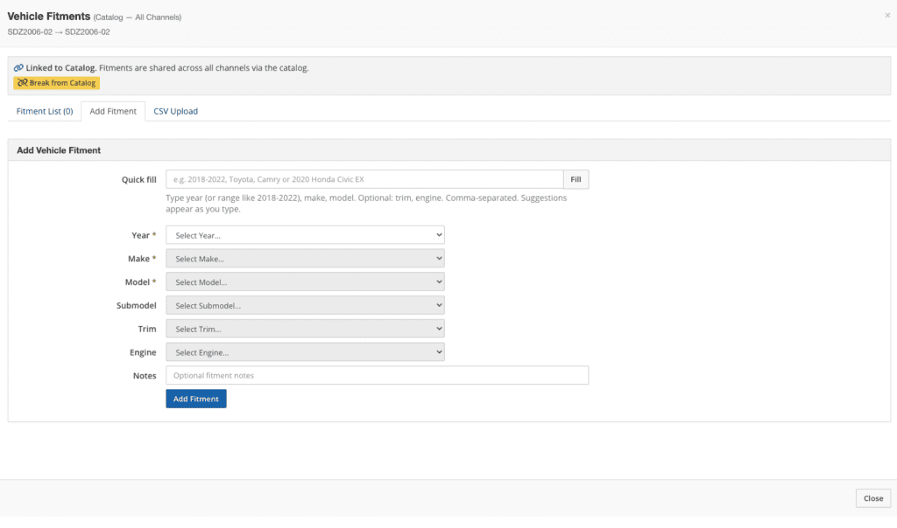

 In our latest product updates, we fixed the small things that slow you down, improved how data moves across channels, and made everyday workflows feel faster and more reliable. From inventory to orders to listings, everything now runs smoother in the background so you can focus on growth, not fixes. Here’s what’s new.

<h2>Newegg Updates
</h2>

<h3>Better Orders, Quantities & Feeds
</h3>

We improved how Newegg handles orders, inventory, and feed submissions across the entire workflow.

<ul>
<li>Orders now correctly reflect paid status</li>
<li>Quantity mismatches between systems have been resolved</li>
<li>Feed validation is stricter to block empty or incorrect submissions </li>
</ul>
<b>What’s new:</b> End-to-end improvements in order processing, inventory accuracy, and feed validation for Newegg integrations. <b>Why it matters:</b> These fixes reduce failed uploads, incorrect order statuses, and inventory mismatches, helping you avoid manual corrections and keep your data reliable.

<h2>Amazon & eBay
</h2>

<h3>Bulk Order Cancellation
</h3>

You can now cancel multiple orders at once across Amazon and eBay, instead of handling them individually.

<ul>
<li>Bulk cancel orders in just a few clicks</li>
<li>Works consistently across both marketplaces</li>
<li>Built for high-volume operations </li>
</ul>
<b>What’s new:</b> A bulk cancellation workflow designed to handle multiple orders quickly across major channels. <b>Why it matters:</b> During peak sales periods, this saves significant time, reduces repetitive work, and ensures your cancellation process stays fast and consistent.

<h2>Inventory & Catalog
</h2>

<h3>Locations, Variants & Product History
</h3>

We strengthened how inventory and catalog data connect and sync with each other.

<ul>
<li>Inventory locations now sync more accurately across products</li>
<li>Variant listings stay aligned even when the location data was missing earlier</li>
<li>Product history now tracks changes in product types </li>
</ul>
<b>What’s new:</b> Improved syncing logic between catalog, variants, and inventory, along with enhanced product change tracking. <b>Why it matters:</b> This reduces the need to rebuild listings or fix data manually and gives you a clearer history for audits and troubleshooting.

<h2>Overstock Improvements
</h2>

<h3>More Stable Sync & Reporting
</h3>

Overstock integrations were upgraded to improve stability and reporting reliability.

<ul>
<li>More consistent account refresh behavior</li>
<li>Better handling of complex inventory scenarios</li>
<li>Improved order import process</li>
<li>CSV export added for reporting</li>
<li>Accurate active account status checks </li>
</ul>
<b>What’s new: </b> Stronger integration stability along with better reporting and inventory handling for Overstock. <b>Why it matters:</b> You get more dependable syncing and clearer reporting, which helps you make better decisions without worrying about data inconsistencies.

<h2>Channel Enhancements
</h2>

<h3>eBay
</h3>

We refined how listings and offers behave to reduce unexpected issues.

<ul>
<li>Improved handling of production listings</li>
<li>Better shipping and buyer name processing</li>
<li>More accurate category specifics and business pricing updates </li>
</ul>
<b>What’s new:</b> More predictable and stable listing updates on eBay. <b>Why it matters:</b> Reduces listing errors and unexpected changes, helping you maintain consistency across your live listings.

<h3>Shopify
</h3>

We made targeted fixes to improve how product data flows between your catalog and storefront.

<ul>
<li>More consistent syncing behavior</li>
<li>Fewer mismatches between backend and storefront data</li>
</ul>
<b>What’s new:</b> Improved reliability in Shopify product data syncing. <b>Why it matters:</b> Keeps your storefront accurate without constant monitoring or manual corrections.

<h3>FBA
</h3>

Shipment workflows were tightened to prevent disruptions.

<ul>
<li>Reduced chances of shipments getting stuck in invalid states</li>
<li>Improved workflow continuity</li>
</ul>
<b>What’s new:</b> More reliable FBA shipment handling. <b>Why it matters:</b> Prevents delays in fulfillment and ensures smoother operations during order processing.

<h2>API Updates
</h2>

<h3>Better Listing Control
</h3>

We added more flexibility to how you manage listings via API.

<ul>
<li>Push dimensions and handling time directly</li>
<li>Control which advanced fields are included in bulk updates </li>
</ul>
<strong>What’s new:</strong> Greater control over listing attributes and bulk update behavior through API. <strong>Why It Matters:</strong> Helps maintain cleaner, more predictable data feeds, especially for teams managing large catalogs programmatically.

<h2>Warehouse Improvements
</h2>

<h3>Better Visibility
</h3>

We improved how warehouse location data is surfaced across the platform.

<ul>
<li>Location details now appear where they are needed most</li>
<li>Better alignment between picking, routing, and setup </li>
</ul>
<strong>What’s new:</strong> Improved visibility of location data across workflows. <strong>Why It Matters:</strong> Reduces time spent searching for information and helps warehouse teams work more efficiently.

<h2>Spotlight Feature
</h2>

<h3>Vehicle Fitments – Major Upgrade
</h3>

Managing vehicle compatibility data is now more flexible and scalable. You can now manage fitments at both levels:

<ul>
<li>Catalog level for shared data across channels</li>
<li>Product level for channel-specific overrides</li>
</ul>

<h3>What You Can Do:
</h3>

<ul><li>Add fitments manually using structured fields</li><li>Upload bulk fitment data via CSV</li><li>Pull fitment data directly from eBay using Item ID or UPC</li><li>Choose between shared or overridden fitment data</li><li>Reconnect listings back to catalog fitments anytime </li>
</ul>
<b>What’s new:</b> Dual-level fitment management with bulk upload, automation, and flexible overrides. <b>Why it matters:</b> It gives you a single source of truth for fitment data while still allowing flexibility when different channels require different configurations.

<h2>Inventory Enhancements

<h3>Catalog Locations Across Variants
</h3>

Variants now automatically inherit location data from the main product or catalog. <b>What’s new:</b> Automatic location syncing across all product variants. <b>Why it matters:</b> Eliminates repetitive data entry and ensures consistency in picking paths and inventory structure.

<h3>Default Location Mapping
</h3>

You can now define default location rules for new or synced products. <b>What’s new:</b> Automated assignment of inventory locations based on predefined rules. <b>Why it matters:</b> Saves setup time and keeps your warehouse organized without manual intervention.

<h2>Performance Boost
</h2>

<h3>Faster Product & Order Search
</h3>

Search performance has been improved across the platform. <b>What’s new:</b> Faster retrieval of product and order data. <b>Why it matters:</b> Helps your team find information quickly, improving efficiency during high-volume operations.

<h2>Supported Channels
</h2>

<h3>Sell Everywhere That Matters
</h3>

 SellerChamp continues to support all major marketplaces and integrations, including Amazon, eBay, Walmart, Shopify, Etsy, Google Shopping, Newegg, Overstock, and more.

<h2>Final Thoughts
</h2>

This month’s updates are all about reducing friction in your day-to-day operations. From faster workflows to more reliable data syncing, every improvement is designed to help your business run more smoothly without extra effort. If you have feedback or features you would like to see next, we are always listening.  <strong>–Team SellerChamp</strong>

{{ site.app.leads }}?utm_source=blog&utm_campaign=sellerchamp-march-2026-product-updates


Schedule a demo today and discover how our Bulk Lister can help you list more products, increase sales, and grow your e-commerce business faster than ever.

