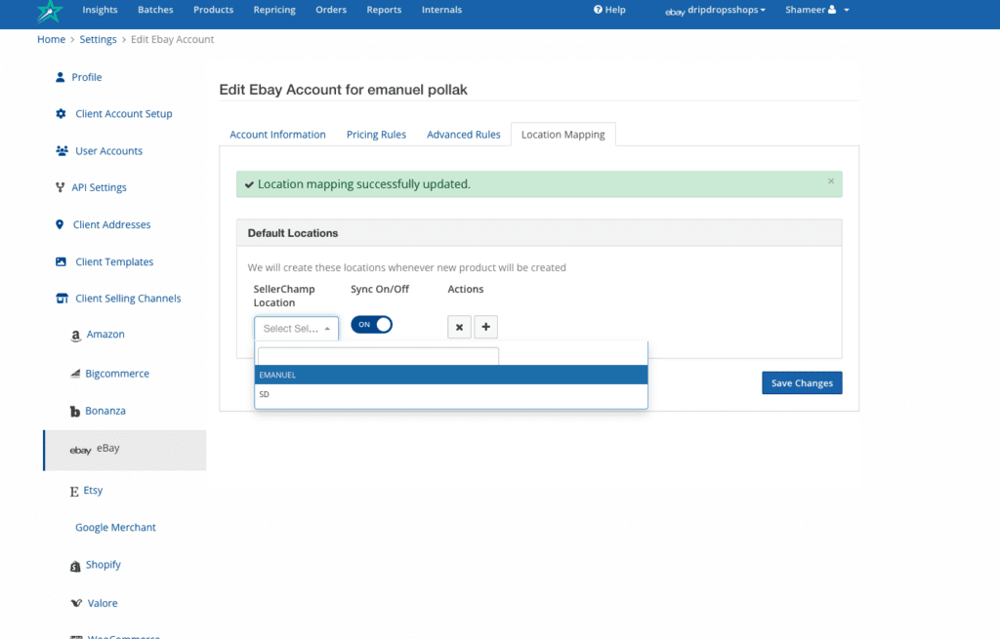
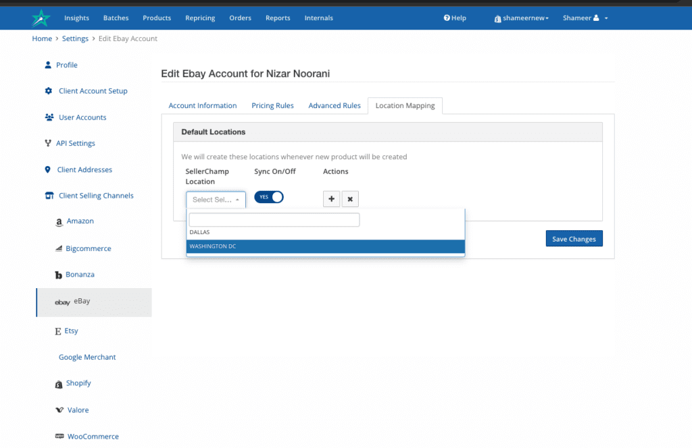

 April was a busy month for updates at SellerChamp. We made improvements to how your inventory, listings, and orders work together so everything feels faster, clearer, and easier to manage. From warehouse locations to marketplace syncing, things now run more smoothly in the background. Here’s what’s new.

<h2>Inventory & Locations
</h2>

<h3>Clearer Inventory Visibility Across Locations
</h3>

 Managing inventory across multiple warehouses should feel simple not scattered. This update brings consistency to how locations are defined, mapped, and reported.

<h3>What's New:
</h3>

<ul><li>Locations are now unified across Client Account Setup and <b>Location Mapping in marketplace accounts</b></li>
</ul>

<ul><li>Select from the same predefined location list everywhere (no manual typing)</li><li>Easier assignment of locations for master catalog products, including bin-level support</li><li>Improved inventory-by-location reporting for better accuracy</li>
</ul>

<h3>Why It Matters:
</h3>

Your location data now stays consistent across setup, listings, and reports. This reduces errors, speeds up workflows, and gives you a clearer view of where your stock actually is.

<h2>Amazon
</h2>

<h3>Less Repetition, More Confidence on Listings
</h3>

Amazon workflows often involve repetitive inputs and limited visibility. This update removes that friction.

<h3>What’s New:
</h3>

<ul><li>Set default brand and country of origin at account or template level</li>
<li>Track first-listed date for each listing</li>
<li>View current Amazon shipping template directly from the edit screen</li>
</ul>

<h3>Why It Matters:
</h3>

You spend less time re-entering data and gain better visibility into listings. That means faster edits, easier audits, and fewer surprises.

<h2>Orders
</h2>

<h3>Bulk Order Actions That Actually Stick
</h3>

Handling large volumes of orders should be predictable. These improvements make bulk workflows more stable.

<h3>What's New:
</h3>

<ul><li>Clear count of selected orders with one-click reset</li><li>Order selection persists across pages</li><li>Automatic quantity resync during order imports</li>
</ul>

<h3>Why It Matters:
</h3>

Bulk actions no longer break when navigating pages, and inventory stays accurate without manual fixes.

<h2>Reports & Exports
</h2>

<h3>Cleaner, More Reliable Reporting
</h3>

Reports should be easy to read and accurate enough to trust. This update improves both.

<h3>What's New:
</h3>

<ul><li>Improved Square reporting with better refresh and clearer naming</li><li>UPC included where relevant</li><li>Cost totals now display in proper currency format </li>
</ul>

<h3>Why It Matters:
</h3>

Cleaner reports make it easier to understand your data and make decisions without second-guessing numbers.

<h2>Marketplace Channels
</h2>

<h3>Smoother Selling Across Every Channel
</h3>

Multi-channel selling depends on reliable syncing. This update strengthens performance across all major integrations.

<h3>What's New:
</h3>
<b>Walmart</b>

<ul>
<li>Improved processing for large listing batches</li>
<li>Variants and parent products clear errors together after successful feeds</li>
</ul>
<b>Shopify</b>

<ul>
<li>Location data now syncs as one clean combined field</li>
</ul>
<b>eBay</b>

<ul>
<li>Faster feed processing</li>
<li>Carrier lists grouped by country</li>
</ul>
<b>Order Alerts</b>

<ul>
<li>Clear warnings when buyers request address changes (Temu, Macy’s, Best Buy)</li>
</ul>
<b>Other Channels</b>

<ul>
<li>General improvements across Newegg, Temu, Fruugo, and Mirakl </li>
</ul>

<h3>Why It Matters:
</h3>

Fewer sync issues, faster updates, and clearer data across channels mean less manual intervention and smoother operations.

<h2>Catalog & Listing Experience
</h2>

<h3>A Cleaner, Faster Workspace
</h3>

Small interface improvements can make a big difference when you’re working in the catalog all day.

<h3>What's New:
</h3>

<ul><li>Wider catalog layout for better visibility</li><li>Option to collapse panels by default</li><li>Smarter feed uploads with flexible shipping handling</li><li>More reliable large file uploads</li>
</ul>

<h3>Why It Matters:
</h3>

A cleaner interface reduces clutter, and improved uploads help you manage large catalogs without interruptions.

<strong><i>Did You Know?</i></strong>

<b>Holiday Workflow Control: </b> Planning around non-working days is now easier. Set holidays to stop automatic pickset generation, so your team avoids unexpected tasks and operations stay predictable.

<h2>Supported Channels
</h2>

<h3>Sell Everywhere That Matters
</h3>

<h2>Final Thoughts
</h2>

This month’s updates focus on one thing: reducing friction across your workflow. From clearer inventory tracking to more reliable bulk actions and smoother marketplace syncing, every improvement is designed to save time and reduce manual effort. More updates are already on the way.  

<b>—SellerChamp Product Team </b>

{{ site.app.leads }}?utm_source=blog&utm_campaign=sellerchamp-april-2026-product-updates


Schedule a demo today and discover how our Bulk Lister can help you list more products, increase sales, and grow your e-commerce business faster than ever.

