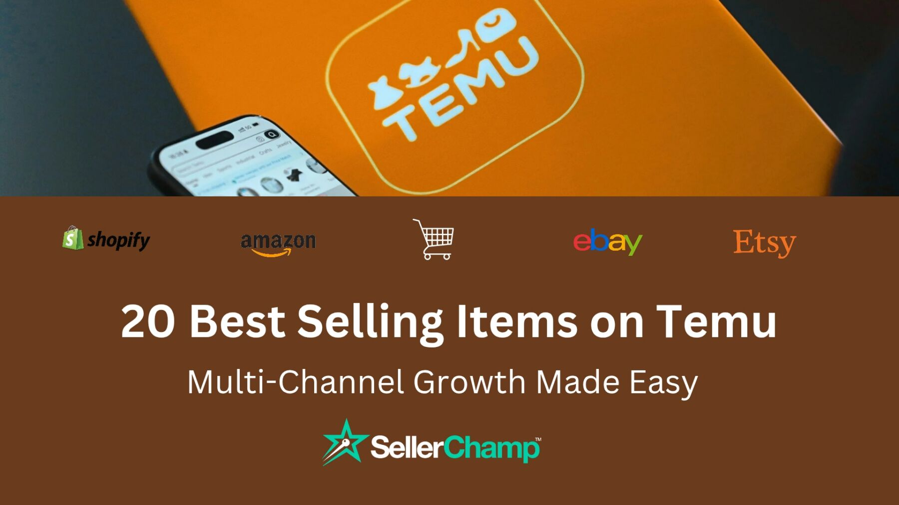
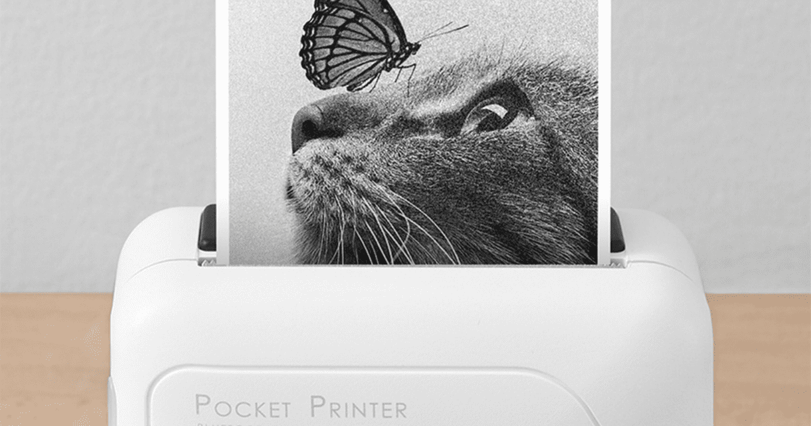
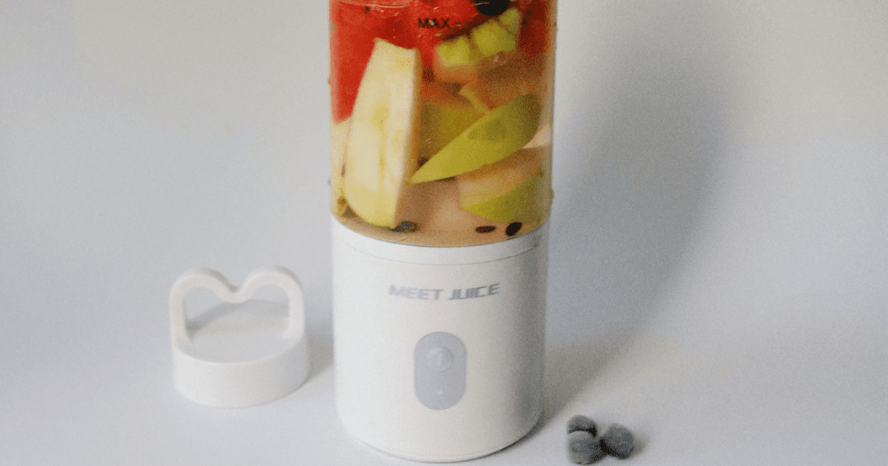
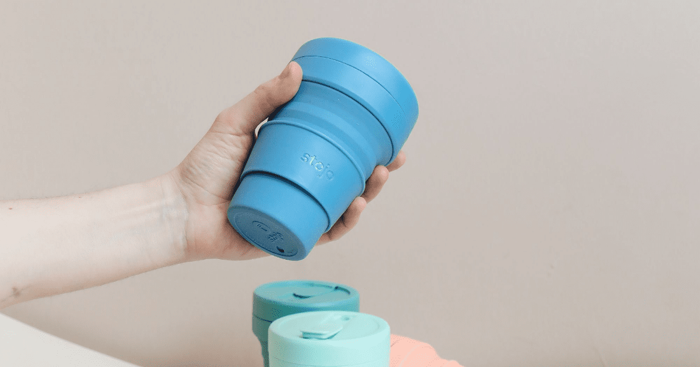
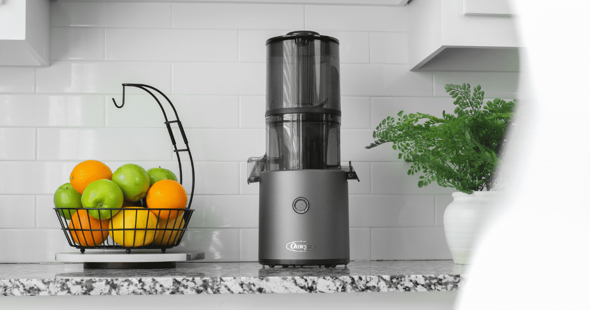
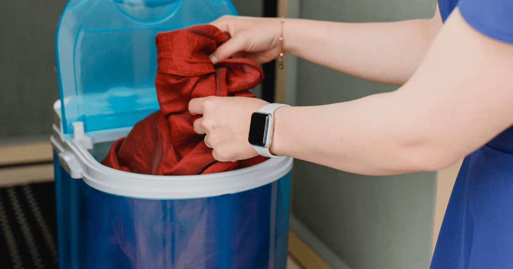
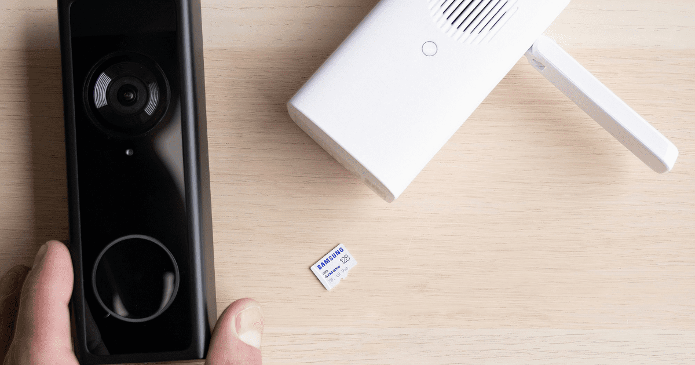
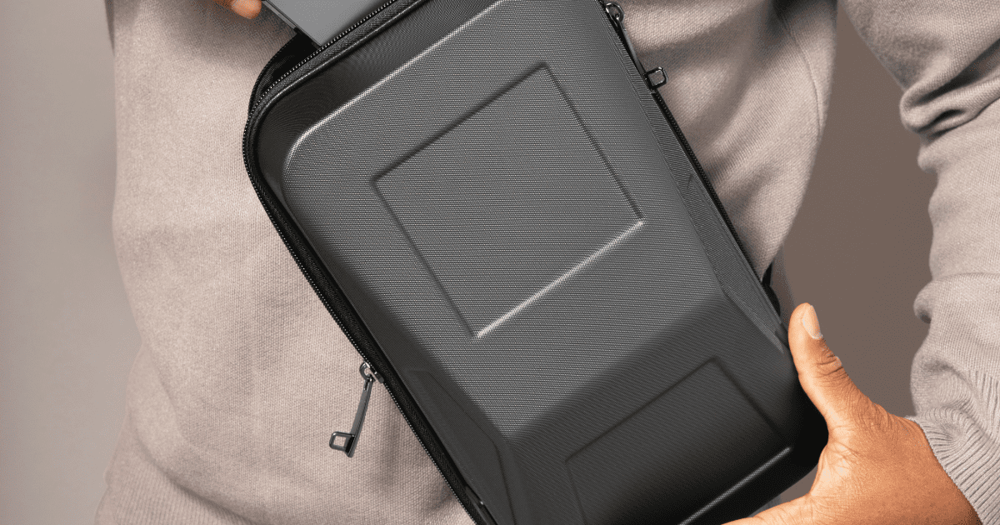
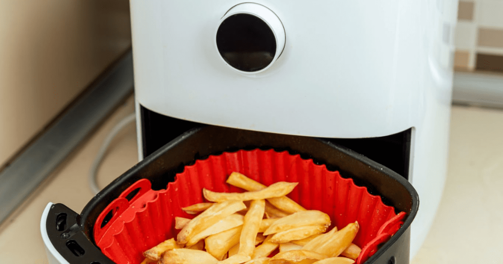
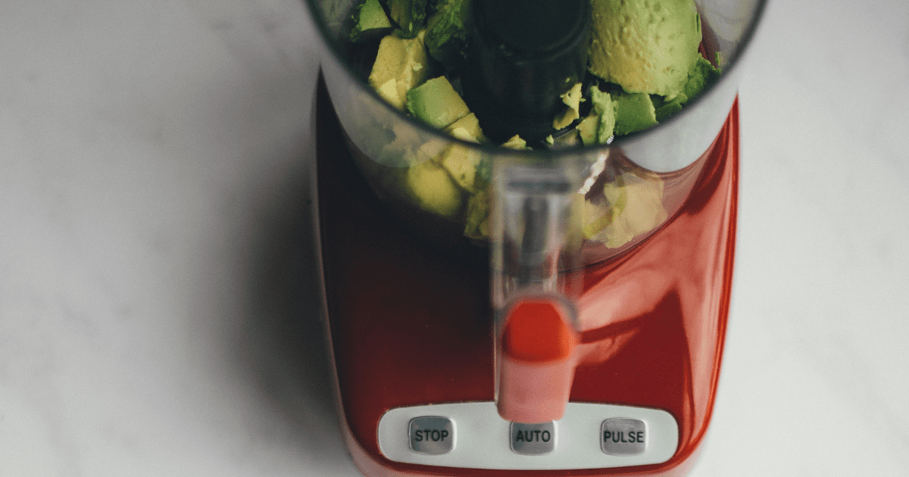

 Temu’s fast growth has made it a goldmine for dropshippers, retail arbitrage sellers, and e-commerce SMEs looking for the <b>best selling items on Temu </b> for maximum profitability. The platform is packed with viral, high-demand products that sell incredibly fast. In this guide, we share the <b>20 top-selling items on Temu </b> right now, along with pricing and profit details to help you scale your business.

<b>Learn More: </b><a href="/blog/how-to-sell-on-temu/"><b>How to Sell on Temu: A Step-by-Step Guide</b></a>

{{ site.app.leads }}?utm_source=blog&utm_campaign=best-selling-items-on-temu


<h2>1. Mini Inkless Pocket Printers:
</h2>

 Students can print photos instantly without ink. Sourcing costs $5 to $7, retails for $25 to $35, giving a 70% profit return. Ideal to stock in warehouses for quick fulfillment on Amazon, eBay, or Temu.

<h2>2. 3-in-1 Foldable Charging Stations:
</h2>

 Foldable charging stations sell the benefit of clutter free desk charging. Sourcing costs $3 to $4, retails for $18 to $25, offering a 78% profit margin. Use an automated tool to sell across multiple channels for best results.

<strong>Read more:</strong><a href="/bulk-lister-seller-champ/"><b>Multi Channel Listing Software – The Bulk Lister</b></a>

<h2>3. Crystal Hair Erasers:
</h2>

Spikes in sales due to painless hair removal results. Sourcing costs under $0.50, retails for $8 to $12, creating a 90% profit potential. Highly recommended for Temu as it is lightweight and very cheap to ship.

<h2>4. Magnetic Motion Sensor LED Lights:
</h2>

 Sells fast in the Home Improvement category. Sourcing costs $1 to $1.50, retails for $10 to $15, providing an 85% profit potential. Works exceptionally well for dropshopping retail sellers.

<b>Learn More: </b><a href="/solutions/dropshipping-automation-software/"><b>Dropshipping Automation software to scale your business</b></a>

<h2>5. Puffy Aesthetic Laptop Sleeves:
</h2>

Viral social media look and trendy color variations. Perfect for the Temu, TikTok Shop. Sourcing costs $1 to $2, retails for $12 to $18, yielding a 75% profit potential.

<h2>6. USB-C Portable Blenders:
</h2>

 Best for health-conscious buyers who love making fresh smoothies while traveling. Sourcing costs $4 to $5, retails for $22 to $28, giving a 75% profit return. Perfect for<a href="https://www.linkedin.com/top-content/sales/b2b-sales-strategies/key-strategies-for-b2b-influencer-marketing/"> influencer marketing</a> and social storefronts.

<h2>7. Pressure-Activated Pet Cooling Mats:
</h2>

Hot-selling Pet item that keeps dogs and cats safe from summer heat. Sourcing costs $2 to $3, with a retail value of $15 to $22, ensuring a 70% profit margin. Great for merchants using <a href="/ecommerce-analytics-tool-insights-reports/">forecasting</a> tools to predict seasonal demand.

<h2>8. Spill-Proof Gradient Tumblers (40oz):
</h2>

 High-end luxury cups at a fraction of the price. Factory <a href="/blog/how-to-source-suppliers-for-your-online-store-2021/">sourcing</a> costs $3 to $4, retails for $20 to $28, leading to a 75% profit potential.Fits perfectly into an independent brand store.

<h2>9. Compact Slow Masticating Juicers:
</h2>

 Masticating juicers make healthy juicing affordable for smaller kitchens. Sourcing costs $10 to $14, retails for $40 to $55, allowing for a 65% profit return.

<h2>10. Budget-Friendly Bluetooth Smartwatches:
</h2>

 Captures budget tech buyers by tracking fitness metrics for a very low price. Sourcing costs $4 to $6, retails for $25 to $35, yielding a 76% profit potential. Excellent for electronic merchants listing across various regional digital storefronts to maximize sales.

<strong>Check out:</strong><a href="/blog/top-tools-for-multi-channel-e-commerce/">
<b>Top 5 Tools for Multi-Channel E-Commerce in 2026</b></a>

<h2>11. Collapsible Bucket Washing Machines:
</h2>

 Campers and apartment renters love the space-saving design. Sourcing costs $7 to $9, retails for $35 to $45, generating a 74% profit margin. Ideal for Temu local shipping to beat overseas delivery speeds.

<h2>12. Wi-Fi Smart Doorbell Cameras:
</h2>

 It offers property protection with easy smartphone setup. Sourcing costs $5 to $7, retails for $30 to $40, offering a 75% profit potential. Best scaled by <a href="/blog/unlock-your-online-stores-potential-a-fun-guide-to-selling-on-multiple-channels/">cross-listing the product</a> simultaneously across utility sites and global digital marketplaces.

<h2>13. Water-Resistant Athleisure Crossbody Bags:
</h2>

 Offers lightweight, hands-free, and affordable travel gear. Sourcing costs $1 to $2, retails for $12 to $16, ensuring an 80% profit margin. Sells incredibly well on fashion-focused platforms targeting young audiences.

<h2>14. High-Suction Handheld Car Vacuums:
</h2>

Consistent Automotive buy because vehicle owners want a tiny tool for quick cabin cleanups. Bulk wholesale sourcing costs $2 to $3, retails for $16 to $22, yielding a 72% profit potential.

<h2>15. Reusable Silicone Air Fryer Liners:
</h2>

 It solves the universal frustration of scrubbing dirty air fryer baskets. Sourcing costs $0.30 to $0.50, retails for $8 to $12, providing an 85% profit potential. Perfect for <a href="/blog/automate-product-listings/">marketplace sellers</a> looking to encourage larger cart sizes at checkout.

<h2>16. Heatless Silk Hair Curler Kits:
</h2>

 Huge viral appeal because it lets users get perfect curls overnight without heat damage. Sourcing costs $0.50 to $1, retails for $10 to $14, creating an 88% profit margin. Great for Temu because the soft materials make overseas shipping cheap and fast.

<h2>17. Hands-Free LED Neck Reading Lights:
</h2>

Niche favorite that lets book lovers read comfortably in the dark. Factory production costs $0.80 to $1.20, retails for $10 to $14, ensuring an 80% profit margin. A prime choice for targeted e-commerce sites or online bookstores.

<b>Explore:</b>
<a href="/blog/how-to-boost-ecommerce-sales-with-generative-ai/"><b>How to Boost E-Commerce Sales With Generative AI</b></a>

<h2>18. Ergonomic EVA Cloud Slippers:
</h2>

 Massive Footwear demand because of its ultra-comfortable foam design. Sourcing costs $1.50 to $2.50, retails for $14 to $20, offering a 77% profit potential.

<h2>19. Pastel Cube Extension Strips with USB:
</h2>

Trends in Home Office because it turns an ugly power strip into a cute, modern desk accessory. Sourcing costs $1.50 to $2.50, retails for $14 to $18, yielding a 75% profit potential.

<strong>You might also like:</strong><a href="/blog/best-ecommerce-product-listing-services/"><b>10 Best E-Commerce Product Listing Services [Updated]</b></a><b>
</b>

<h2>20. 14-in-1 Multifunctional Veggie Choppers:
</h2>

 Captures fast attention because it cuts food preparation time down to seconds. Bulk manufacturing costs $2.50 to $3.50, retails for $18 to $25, giving a 76% profit return. Perfect for video-driven social commerce where buyers look for highly reviewed problem-solvers.

<h2>Frequently Asked Questions (FAQs)
</h2>

<h3>Q: What are the best selling items on Temu right now?
</h3>

Home gadgets, kitchen tools, beauty essentials, and budget wearables consistently top Temu’s best-seller lists.

<h3>Q: How do I manage selling these products across multiple stores at the same time?
</h3>

The most effective method is to use automated software that connects all your storefronts into one central dashboard.

<h3>Q: Which marketplaces are best for reselling these specific Temu items?
</h3>

Trendy visual items sell best on TikTok Shop and Shopify through social media videos. Problem-solving gadgets sell best on Amazon and eBay where people actively search for solutions.

<h3>Q: How do I know when a Temu product trend is dying so I do not get stuck with extra stock?
</h3>

You can use an inventory forecasting tool to track your sales speed. It tells you exactly when demand is slowing down so you can stop ordering more inventory before it is too late.

<h2><a href="https://app.sellerchamp.com/leads/new">Ready to List Faster? </a>
</h2>

<h5>Request a SellerChamp Demo
</h5>

<em><a style="color: #ffffff;" href="https://app.sellerchamp.com/leads/new?utm_source=blog&utm_campaign=best-selling-items-on-temu">Schedule a demo and see how SellerChamp’s Bulk Lister can help you list trending products faster across every channel. </a></em>

