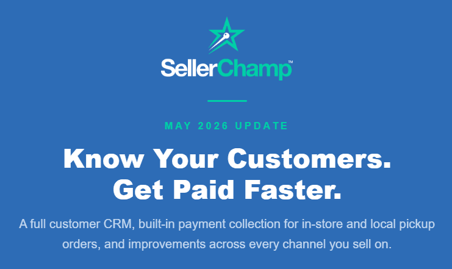
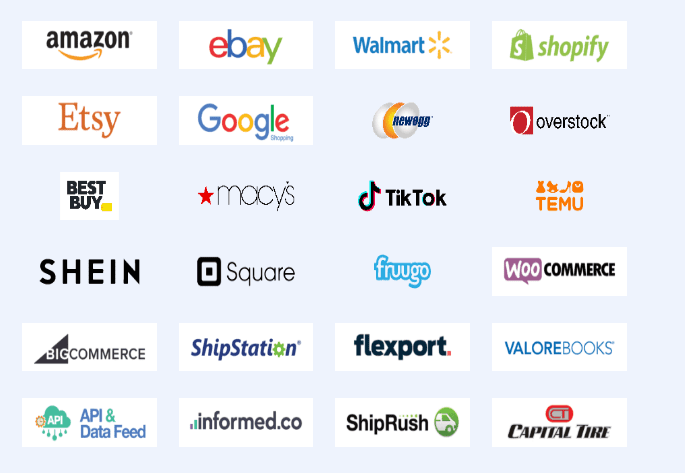

 At SellerChamp, we’re focused on helping sellers simplify operations, improve efficiency, and grow across every sales channel.b This month brings one of our most significant updates yet, introducing customer management, built-in payment collection, inventory enhancements, and a wide range of improvements across Amazon, Walmart, Shopify, reporting, and fulfillment. Let’s dive into what’s new.

<h2>Spotlight Feature
</h2>

<h3>Customer Management and Payments
</h3>

This month’s biggest release helps you centralize customer information and collect payments for local orders without leaving SellerChamp.

<h3>What's New:
</h3>

SellerChamp now automatically builds a customer directory from every order across your connected sales channels. Every customer profile is organized, searchable, and updated automatically as new orders come in.    Key additions include:

<ul class="lst-kix_ulfl30qzsyzg-0 start">
<li>Full customer directory with search, sorting, and filtering options</li>
<li>Visibility into customer order history and lifetime spend</li>
<li>Automatic customer profile creation from incoming orders</li>
<li>Smart duplicate customer merging</li>
<li>One-click customer autofill when creating manual orders</li>
<li>CSV export for reporting, marketing, and external tools</li>
</ul>

We’ve also launched built-in payment collection for in-store and local pickup orders through Authorize.net. Sellers can now securely charge customers directly from an order within SellerChamp. Additional payment features include:

<ul class="lst-kix_7rdlfb9b5hwd-0 start">
<li>Secure PCI-compliant hosted payment form</li>
<li>Automatic order total population</li>
<li>Instant paid status updates after successful transactions</li>
<li>Simple one-time Authorize.net setup and verification</li>
</ul>

<h3>Why It Matters:
</h3>

Customer information is often spread across multiple marketplaces, making it difficult to understand buying history and manage relationships. A centralized customer directory gives you a complete view of your customers in one place. Built-in payment collection removes extra steps from local sales and pickup orders, helping you get paid faster without switching between different systems.

<h2> Inventory and Location Improvements
</h2>

<h3>Smarter Inventory Across Locations
</h3>

Managing inventory across multiple locations requires accurate stock data and flexible controls. These updates help improve inventory consistency while giving sellers more control over catalog synchronization.

<h3>What’s New:
</h3>

<ul class="lst-kix_mfi8zchzkxmc-0 start"><li>FBA quantity normalization for more consistent inventory counts across your catalog</li><li>Master catalog sync controls that let you decide whether updates should sync back to the master catalog</li>
</ul>

<h3>Why It Matters:
</h3>

Accurate inventory helps prevent overselling and keeps marketplace listings aligned with available stock. The new sync controls also provide greater flexibility when making channel-specific adjustments.

<h2>Amazon Updates
</h2>

<h3>Cleaner Amazon Listings & Safer Syncing
</h3>

Several Amazon improvements have been released to make listing management simpler, safer, and more reliable.

<h3>What's New:
</h3>

<ul><li>Smarter category-specific attribute filtering so only relevant fields appear when editing listings</li><li>Improved image synchronization for more reliable image updates</li><li>Protection for ended listings to prevent accidental republishing</li><li>Preservation of alternate SKU mappings during synchronization </li>
</ul>

<h3>Why It Matters:
</h3>

These improvements reduce listing errors, improve catalog accuracy, and help protect custom listing configurations from being overwritten during sync operations.

<h2>Walmart Enhancements
</h2>

<h3>Walmart Variant & Listing Improvements
</h3>

New Walmart updates improve visibility into listing issues and strengthen synchronization between Walmart and SellerChamp.

<h3>What's New:
</h3>

<ul class="lst-kix_y6dyt1aa01b4-0 start"><li>Variant publishing errors are now visible directly from the product listing screen</li><li>Walmart-assigned item IDs for UPC-exempt products are now saved and reused correctly</li><li>Faster and more accurate Walmart listing status updates</li>
</ul>

<h3>Why It Matters:
</h3>

Sellers can identify listing problems more quickly, maintain stronger listing connections, and spend less time troubleshooting synchronization issues.

<h2>Orders and Fulfillment Improvements
</h2>

<h3>Faster Labels & Smarter Order Handling
</h3>

Order processing continues to get faster with updates designed to streamline fulfillment workflows and reduce manual work.

<h3>What's New:
</h3>

<ul class="lst-kix_43ft7znjguf2-0 start"><li>Faster batch shipping label generation through parallel processing</li><li>Direct cancellation of individual Newegg order items from SellerChamp</li><li>Improved Shopify collection synchronization </li>
</ul>

<h3>Why It Matters:
</h3>

These enhancements help fulfillment teams process orders more efficiently, reduce delays, and eliminate the need to switch between multiple seller platforms.

<h2>Catalog and Listing Workflow Updates
</h2>

<h3>Tidier Catalogs & Smarter Workflows
</h3>

Catalog management should be simple and efficient. These updates help reduce repetitive tasks and improve workflow visibility.

<h3>What's New:
</h3>

<ul class="lst-kix_t078vtvhsuqc-0 start"><li>Manifest tabs now remain selected while navigating between screens</li><li>Bulk mark-as-valid functionality for catalog items</li><li>Revision history tracking for catalog changes</li><li>Automatic removal of empty manifests </li>
</ul>

<h3>Why It Matters:
</h3>

These workflow improvements save time, improve organization, and make it easier to track catalog updates across your team.

<h2>Reporting and Export Enhancements
</h2>

<h3>More Data in Your Reports
</h3>

Reporting tools now include additional product and inventory data to support operational and financial decision-making.

<h3>What's New:
</h3>

<ul>
<li>Country of origin included in product exports</li>
<li>Average product cost reporting by location</li>
</ul>

<h3>Why It Matters:
</h3>

These additions help sellers manage compliance requirements while gaining better visibility into inventory costs and warehouse-level profitability.

<strong><i>Did You Know?</i></strong>

SellerChamp includes several built-in tools that can help you prepare for peak selling periods and improve warehouse efficiency.

<ul class="lst-kix_2jqgtxfzn7cl-0 start"><li>

<h3>Holiday and Sales Preparation
</h3></li>
</ul>

You can schedule quantity and pricing changes in advance for upcoming sales events, promotions, and holiday seasons. Set everything ahead of time and let SellerChamp handle the updates automatically.

<ul class="lst-kix_lw2xczh2d592-0 start"><li>

<h3>Picksets for Faster Fulfillment
</h3></li>
</ul>

Picksets allow warehouse teams to group products that are frequently picked together, reducing travel time and helping fulfill multiple orders more efficiently.

<h2>Supported Channels
</h2>

<h3>Sell Everywhere That Matters
</h3>

<h2>Final Thoughts
</h2>

This month’s updates focus on making your daily work easier. From managing customers and taking payments to improving inventory, orders, and marketplace workflows, everything is designed to save you time and reduce extra steps. Thanks for your feedback and support. We’ll keep improving SellerChamp to help you sell more with less effort. <b>—Team SellerChamp</b>

{{ site.app.leads }}?utm_source=blog&utm_campaign=sellerchamp-may-2026-product-updates


Schedule a demo today and discover how our Bulk Lister can help you list more products, increase sales, and grow your e-commerce business faster than ever.

