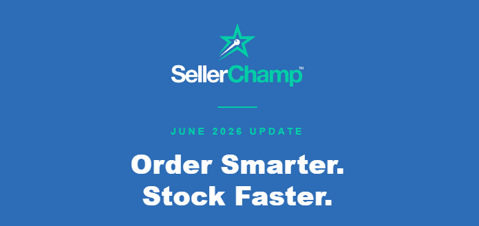
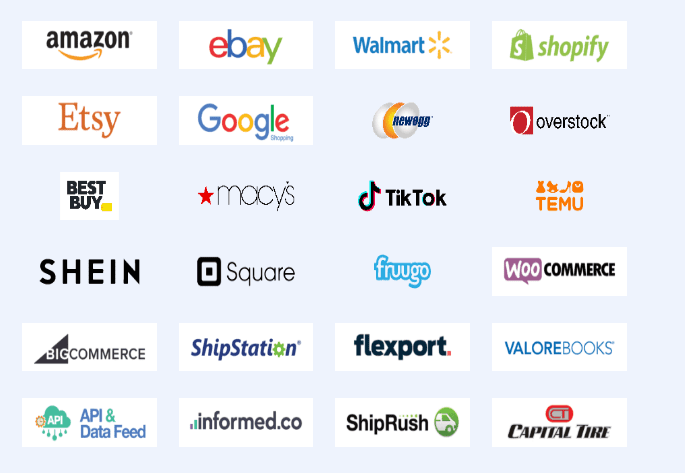

 June was packed with major upgrades designed to help sellers move faster, stay organized, and manage inventory more efficiently across every sales channel. From built-in purchase orders to POS integrations and marketplace improvements, these updates focus on reducing manual work while giving you more control over your operations. Here’s what’s new this month.

<h2>Spotlight Feature
</h2>

<h3>Built-In Purchase Orders
</h3>

Managing purchasing, receiving inventory, and listing products now happens directly inside SellerChamp.

<h3>What's New:
</h3>

SellerChamp now includes a complete Purchase Order workflow built directly into the catalog system. Key additions include:

<ul>
<li>Create purchase orders with supplier details, notes, and optional auto-generated PO numbers</li>
<li>Add products by scanning or entering SKU, UPC, or ASIN</li>
<li>Bulk upload purchase order items using CSV imports</li>
<li>Create new catalog products directly from the PO screen</li>
<li>Receive inventory into specific warehouse locations</li>
<li>Track PO status from open to partially received to fully received</li>
<li>List received products directly to connected sales channels from the same workflow</li>
<li>Background processing for large CSV imports and receiving jobs</li>
</ul>

<h3>Why It Matters:
</h3>

Managing purchasing separately from inventory and listing workflows creates unnecessary steps and delays. Built-in purchase orders keep your purchasing, receiving, and selling workflows connected in one place. This helps sellers receive inventory faster, reduce manual entry, and move products to marketplaces more efficiently.

<h2>Catalog Updates
</h2>

<h3>Faster Catalog Uploads & Smarter Variant Handling
</h3>

Catalog management is now more flexible and easier to scale.

<h3>What’s New:
</h3>

Several catalog improvements were released this month, including:

<ul>
<li>Bulk catalog uploads using CSV templates</li>
<li>Support for creating and updating parent, single, and variant products in bulk</li>
<li>Background processing for large catalog imports</li>
<li>Enhancement options for variants that share the same inventory</li>
<li>Channel-specific enhancement option selection during listing </li>
</ul>

<h3>Why It Matters:
</h3>

Bulk uploads reduce the time required to build and maintain large catalogs. Enhancement options also make listings cleaner by allowing buyers to select add-ons or preferences without creating duplicate inventory SKUs. This simplifies inventory management while improving the customer buying experience.

<h2>POS Integration
</h2>

<h3>PayPal Zettle Integration
</h3>

SellerChamp now supports PayPal Zettle as a POS integration.

<h3>What's New:
</h3>

You can now connect your PayPal Zettle account directly through SellerChamp using OAuth authentication.    Additional features include:

<ul>
<li>Inventory location mapping</li>
<li>Automatic tax rate syncing from Zettle</li>
<li>POS purchase order imports</li>
<li>Batch listing support</li>
<li>Account refresh and syncing tools</li>
<li>Listing limits and handling time controls</li>
</ul>

<h3>Why It Matters:
</h3>

POS integrations help unify in-store and online inventory operations. Connecting PayPal Zettle allows sellers to sync inventory more accurately and reduce the need for manual updates between systems. This helps prevent stock inconsistencies and keeps fulfillment workflows running smoothly.

<h2>Walmart Improvements
</h2>

<h3>Simpler Walmart Connections with OAuth 2.0
</h3>

Connecting Walmart accounts is now faster and more secure.

<h3>What's New:
</h3>

US Walmart sellers can now connect SellerChamp using Walmart’s OAuth 2.0 authorization flow instead of manually entering API credentials.    Additional improvements include:

<ul>
<li>Automatic token refresh handling</li>
<li>Token expiration visibility inside account settings</li>
<li>Simplified account authorization setup </li>
</ul>

<h3>Why It Matters:
</h3>

OAuth connections improve account security while reducing setup complexity. Sellers can connect Walmart accounts faster without manually managing API credentials or worrying about expired tokens interrupting syncing.

<h2>Temu Enhancements
</h2>

<h3>Support for Pre-Owned Listings on Temu
</h3>

SellerChamp now supports pre-owned inventory workflows for approved Temu sellers.

<h3>What's New:
</h3>

If your Temu account is approved for second-hand sales, SellerChamp can now:

<ul>
<li>Send condition data for used products</li>
<li>Map item conditions during imports</li>
<li>Keep product condition information synced between platforms </li>
</ul>

<h3>Why It Matters:
</h3>

Selling pre-owned products requires accurate condition mapping to avoid listing issues and customer confusion. These updates help sellers maintain consistency while expanding into second-hand marketplaces.

<h2>Orders & Shipping
</h2>

<h3>Smarter Order Numbers and Shipping Validation
</h3>

Order creation and shipping workflows now include additional automation and validation tools.

<h3>What's New:
</h3>

This month’s order and shipping improvements include:

<ul>
<li>Auto-generated manual order numbers</li>
<li>Automatic US address verification before label purchases</li>
<li>Manual address validation options inside shipments</li>
<li>Failed address warnings before purchasing labels </li>
</ul>

<h3>Why It Matters:
</h3>

Automated order numbering reduces manual entry errors, while address validation helps prevent failed deliveries and costly shipping mistakes. These updates improve fulfillment accuracy and reduce wasted shipping costs.

<h2>Listings Improvements
</h2>

<h3>Easier Variant Option Management
</h3>

Managing listing variations is now more flexible.

<h3>What's New:
</h3>

SellerChamp now allows sellers to:

<ul>
<li>Remove saved variant options directly from listing variant modals</li>
<li>Instantly refresh listing variant data after updates </li>
</ul>

<h3>Why It Matters:
</h3>

This makes it easier to clean up outdated variation data and maintain accurate product configurations across marketplaces.

<h2>Catalog Performance Improvements
</h2>

<h3>Faster Catalog Navigation & Better Filtering
</h3>

Large catalogs now load and filter significantly faster.

<h3>What's New:
</h3>

Catalog performance updates include:

<ul>
<li>Faster catalog page loading</li>
<li>Bulk image preloading</li>
<li>Parent product links on variant rows</li>
<li>New brand filtering options</li>
<li>Marketplace ID support in catalog exports </li>
</ul>

<h3>Why It Matters:
</h3>

Managing large catalogs becomes much easier when filters, exports, and navigation tools respond quickly. These improvements save time and improve overall workflow efficiency for growing sellers.

<h2>Marketplace Improvements
</h2>

<h3>Amazon, eBay & Shopify Enhancements
</h3>

Several marketplace-specific improvements were released this month.

<h3>What's New:
</h3>

Amazon updates include:

<ul>
<li>Better brand data refreshing for brand-owner accounts</li>
<li>Improved reseller variant listing behavior</li>
</ul>
<i>eBay updates include:</i>

<ul>
<li>Automatic image resizing for small images</li>
<li>Full variation family imports from scanned Item IDs</li>
<li>Shipping policy support in exports</li>
<li>Inventory reservation for unpaid orders</li>
</ul>
<i>Shopify updates include:</i>

<ul>
<li>Product dimension syncing</li>
<li>Correct Shopify POS fulfillment handling</li>
<li>Protection for edited titles and brand fields during refreshes </li>
</ul>

<h3>Why It Matters:
</h3>

Marketplace syncing improvements reduce listing errors, improve catalog consistency, and help sellers avoid inventory and fulfillment issues across multiple channels.

<h2>Orders & Fulfillment Improvements
</h2>

<h3>Better Shipping and Listing Controls
</h3>

Shipping workflows now include more visibility and safeguards.

<h3>What's New:
</h3>

Additional improvements include:

<ul>
<li>Two-step bulk label purchasing flow</li>
<li>Highlighted problem rows before label confirmation</li>
<li>Preserved FBA/FBM fulfillment types when copying listings</li>
<li>Optional listing blocks for products without images </li>
</ul>

<h3>Why It Matters:
</h3>

These updates reduce fulfillment mistakes, improve listing quality, and help sellers catch problems before products go live or labels are purchased.

<h2>Other Channel Improvements
</h2>

<h3>Best Buy, Fruugo, BigCommerce & ShipStation Fixes
</h3>

Several additional marketplace fixes and enhancements were released.

<h3>What's New:
</h3>

Updates include:

<ul>
<li>Multi-select category specifics for Best Buy</li>
<li>Fruugo weight conversion fixes</li>
<li>ShipStation pagination sync improvements</li>
<li>BigCommerce duplicate product and MPN conflict fixes </li>
</ul>

<h3>Why It Matters:
</h3>

Small syncing improvements across channels help reduce operational issues and improve listing accuracy across your entire selling ecosystem.

<strong><em>Did You Know?</em></strong>

<h3>Holiday & Sales Preparation
</h3>

Schedule quantity and pricing updates ahead of sales events and holiday promotions so changes happen automatically when needed.

<h3>Picksets for Faster Fulfillment
</h3>

Use Picksets to group products frequently picked together, helping warehouse teams fulfill multiple orders more efficiently.

<h2>Supported Channels
</h2>

<h3>Sell Everywhere That Matters
</h3>

<h2>Final Thoughts
</h2>

This month’s updates focus on making inventory, purchasing, fulfillment, and marketplace management more connected and efficient. From built-in purchase orders to stronger marketplace integrations and smarter fulfillment workflows, every improvement is designed to help you save time and scale operations more smoothly. Thanks for your continued feedback and support. <b>—Team SellerChamp</b>

{{ site.app.leads }}?utm_source=blog&utm_campaign=sellerchamp-june-2026-product-updates


Schedule a demo today and discover how our Bulk Lister can help you list more products, increase sales, and grow your e-commerce business faster than ever.

