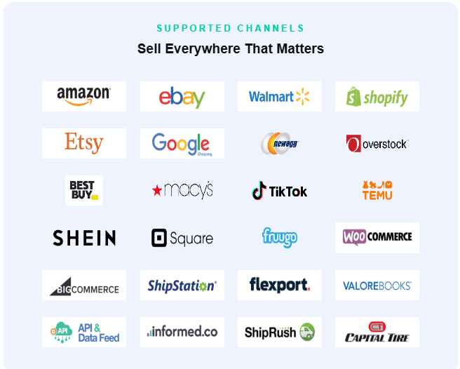

July brings another major round of improvements to help you expand to new marketplaces, simplify catalog management, and make smarter inventory decisions.

From full SHEIN marketplace support to AI-powered product lookup, backorder tracking, and SKU-level profit insights, these updates are designed to help you work faster and sell more efficiently.

Here’s what’s new this month.

<h2>Spotlight Feature
</h2>

<h3>SHEIN Is Now a SellerChamp Selling Channel
</h3>

SellerChamp now fully supports SHEIN, allowing you to manage your products, inventory, and orders alongside every other connected marketplace.

<h3>What's New:
</h3>

You can now connect your SHEIN account and manage it entirely from SellerChamp.

Key capabilities include:

<ul>

<li>List products directly to SHEIN</li>

<li>Manage categories and item specifics</li>

<li>Update existing SHEIN listings</li>

<li>Automatically sync inventory across channels</li>

<li>Import and fulfill SHEIN orders</li>

<li>Process cancellations and refund workflows</li>

<li>Keep inventory synchronized as orders are placed across all marketplaces</li>

</ul>

<h3>Why It Matters:
</h3>

Managing SHEIN alongside your other sales channels eliminates the need to switch between platforms. SellerChamp keeps your listings, inventory, and orders synchronized so you can sell confidently across every marketplace from one place.

<h2>Catalog Updates
</h2>

<h3>Catalog Listing Batches
</h3>

Organize products before publishing them to your sales channels.

<h3>What’s New:
</h3>

SellerChamp now lets you create listing batches directly from your master catalog.

You can:

<ul>

<li>Scan or add products into batches</li>

<li>Match products with catalog items</li>

<li>Prepare listings before publishing to your selling channels</li>

<li>Use the same familiar batch workflow across all marketplaces
</li>

</ul>

<h3>Why It Matters:
</h3>

Creating batches directly from your catalog speeds up listing preparation while keeping your master catalog at the center of your workflow.

<h2>AI-Powered Photo Product Lookup
</h2>

Let AI identify products from a single image.

<h3>What's New:
</h3>

Upload a product image while creating catalog items or batch lines, and SellerChamp automatically reads identifiers and product information from the image.

When a match is found, SellerChamp fills product details automatically after confirmation.

<h3>Why It Matters:
</h3>

Photo-based lookup speeds up catalog creation while improving product accuracy.

<h2>Catalog Product Lookup
</h2>

Populate catalog data automatically using product identifiers.

<h3>What's New:
</h3>

Search products using:

<ul>

<li>UPC</li>

<li>ASIN</li>

<li>Keywords</li>

<li>Other product identifiers</li>

</ul>

SellerChamp automatically imports:

<ul>

<li>Product titles</li>

<li>Descriptions</li>

<li>Images</li>

<li>Product attributes
</li>

</ul>

<h3>Why It Matters:
</h3>

Automatic product lookup reduces manual data entry and helps you build complete, accurate product listings in less time.

<h2>Backorder Tracking
</h2>

Track customer demand even when products are temporarily unavailable.

<h3>What's New:
</h3>

With Catalog Sync enabled, you can now:

<ul>

<li>Enable backorders</li>

<li>Track open backorder quantities</li>

<li>Replenish inventory manually</li>

<li>Automatically replenish backorders when inventory returns
</li>

</ul>

<h3>Why It Matters:
</h3>

Backorder tracking prevents demand from being lost when products sell out, helping you plan inventory more effectively and recover sales once stock is replenished.

<h2>Purchase Orders
</h2>

<h3>Smart Reorder Recommendations
</h3>

Take the guesswork out of replenishing inventory.

<h3>What's New:
</h3>

SellerChamp now generates reorder recommendations based on:

<ul>

<li>Sales history</li>

<li>Supplier lead times</li>

<li>Safety stock buffers</li>

<li>Peak-season demand</li>

</ul>

You can also export recommendations as CSV files and configure default purchasing settings.

<h3>Why It Matters:
</h3>

Smart reorder recommendations help maintain optimal inventory levels while reducing the risk of overstocking or running out of products.

<h2>Orders
</h2>

<h3>Orders Status Sidebar
</h3>

Finding the orders that need attention is now much easier.

<h3>What's New:
</h3>

The Orders page now includes a sidebar displaying order counts by:

<ul>

<li>Order status</li>

<li>Store</li>

</ul>

Clicking any status or store instantly filters the order list.

<h3>Why It Matters:
</h3>

The new sidebar makes order management faster by providing immediate visibility into pending work without navigating multiple filters.

<h2>Insights
</h2>

<h3>Sales by SKU Revenue & Profit Breakdown
</h3>

Gain deeper visibility into product performance.

<h3>What's New:
</h3>

Under <b>Insights > Revenue > By SKU</b>, you can now view:

<ul>

<li>Quantity sold</li>

<li>Revenue</li>

<li>Cost</li>

<li>Profit</li>

</ul>

Reports are available by both Channel SKU and Catalog SKU.

You can also:

<ul>

<li>View performance charts</li>

<li>Export reports to CSV </li>

</ul>

<h3>Why It Matters:
</h3>

SKU-level reporting helps identify your most profitable products so you can make more informed purchasing and selling decisions.

<h2>Team & Permissions
</h2>

<h3>Reports Access Permission
</h3>

Control who can access business reports.

<h3>What's New:
</h3>

Team profiles now include a <b>View Reports</b> permission, allowing administrators to grant or restrict access to the Reports section.

<h3>Why It Matters:
</h3>

Restricting report access helps protect financial information while giving team members access only to the data they need.

<h2>Best Buy Updates
</h2>

<h3>Best Buy Canada Support
</h3>

SellerChamp now supports Best Buy Canada.

<h3>What's New:
</h3>

When connecting your Best Buy account, you can now select Canada as your marketplace.

Support includes:

<ul>

<li>Canada-specific listing requirements</li>

<li>Category structures</li>

<li>Order management</li>

<li>Refund workflows
</li>

</ul>

<h3>Why It Matters:
</h3>

Canadian sellers can now manage Best Buy Canada directly through SellerChamp without separate workflows.

<h2>Catalog Enhancements
</h2>

<h3>Faster Catalog Workflows
</h3>

Several catalog improvements make everyday management even easier.

<h3>What's New:
</h3>

This month’s catalog enhancements include:

<ul>

<li>Select which fields automatically populate during product lookup</li>

<li>Richer lookup data with custom field support</li>

<li>Quantity and warehouse location support on batch lines</li>

<li>Clearer synchronization messaging when editing catalog items and listings
</li>

</ul>

<h3>Why It Matters:
</h3>

These enhancements provide greater control over catalog data while reducing manual editing and improving workflow visibility.

<h2>Purchase Orders Improvements
</h2>

<h3>Cost Price Support for CSV Imports
</h3>

Purchase order imports now include more detailed cost tracking.

<h3>What's New:
</h3>

CSV purchase order imports now support cost price values for every line item, helping maintain accurate landed costs during bulk imports.

<h3>Why It Matters:
</h3>

Including cost prices during import reduces manual updates and improves purchasing accuracy.

<h2>Orders & Reports Improvements
</h2>

<h3>Catalog SKU in Orders Export
</h3>

Reconciling orders with your catalog is now easier.

<h3>What's New:
</h3>

Orders CSV exports now include a Catalog SKU column for easier matching between marketplace orders and your master catalog.

<h3>Why It Matters:
</h3>

The additional Catalog SKU field simplifies reporting and inventory reconciliation across multiple selling channels.

<h2>Walmart & Amazon Improvements
</h2>

<h3>Listing Quality Enhancements
</h3>

Marketplace listing quality continues to improve.

<h3>What's New:
</h3>

<b>Walmart</b>

<ul>

<li>Improved handling for remanufactured, pre-owned, and other special-condition products</li>

<li>Better identifier matching for successful listings</li>

</ul>

<b>Amazon</b>

<ul>

<li>Blank or unbranded products are automatically standardized as <b>Generic</b> during listing submission to comply with Amazon requirements</li>

</ul>

<h3>Why It Matters:
</h3>

These improvements reduce listing errors and improve product acceptance across major marketplaces.

<h3>Did You Know?
</h3>

<b>PO Recommendations + Backorders:</b> Combine smart reorder recommendations with backorder tracking to create a complete replenishment workflow that helps maintain inventory while capturing customer demand.

<b>Sales by SKU + Catalog Lookup: </b> Use SKU profit reports to identify your best-selling products, then quickly discover and add similar products using Catalog Lookup to grow your inventory faster.

<h2>Supported Channels
</h2>

<h3>Sell Everywhere That Matters
</h3>

<h2>Final Thoughts
</h2>

July’s release gives sellers more ways to grow while reducing the manual work involved in managing products, inventory, and orders.

Whether you’re expanding to SHEIN, optimizing purchasing with smarter inventory tools, or analyzing SKU profitability, these updates help streamline day-to-day operations from one platform. 

Thanks for your continued feedback and support.

<b>—Team SellerChamp</b>

{{ site.app.leads }}?utm_source=blog&utm_campaign=sellerchamp-july-2026-product-updates


 Azmi
