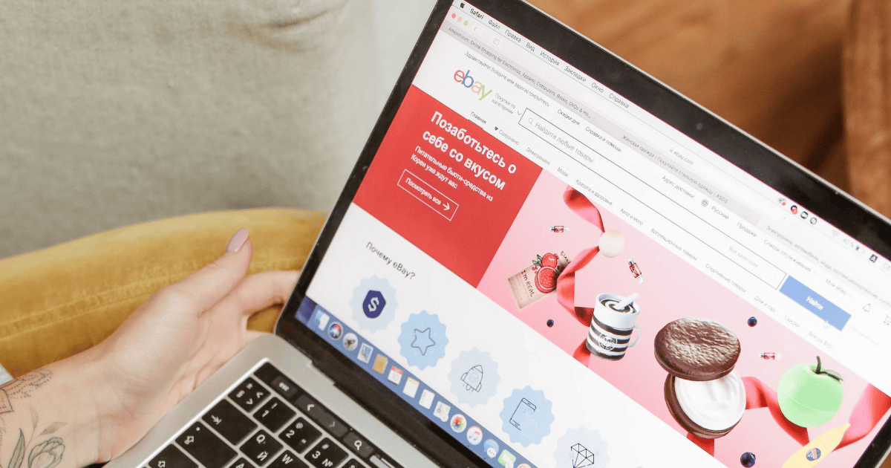
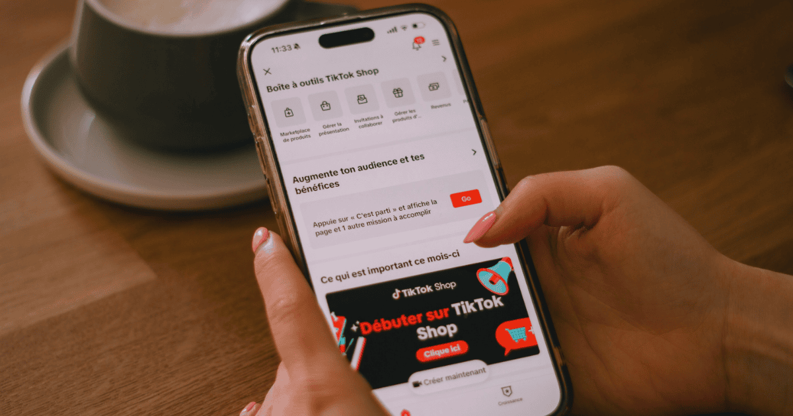

Amazon, eBay, TikTok Shop, and Shein each hand you <b>free, built-in tools</b> that reveal exactly what’s moving, if you know where to look. This guide walks through the concrete steps on <b>how to find the top-selling items on every e-commerce platform</b> with benchmarks and stats so you can <b>start sourcing and selling</b> with the right foundation.

<strong>You might also like:</strong>

<a href="/blog/automate-product-listings/">

<b>How to Automate Product Listings Across Marketplaces?</b>

</a>

<b>

</b>

{{ site.app.leads }}?utm_source=blog&utm_campaign=how-to-find-top-selling-items


<h2>How to Find Top-Selling Items on Amazon
</h2>

Amazon’s own product research guidance points straight to the <a href="https://www.amazon.com/Best-Sellers/zgbs">

<b>Best Sellers</b>

</a> and <b>Movers & Shakers</b> pages as the starting point for any product decision.

<ul>

<li>

<b>Check Best Sellers by category: </b>

<a href="https://sell.amazon.com/blog/amazon-best-sellers-rank">Amazon’s Best Sellers Rank</a> (BSR) updates hourly. A <b>BSR under 5,000</b> in a main category typically signals a product is moving real volume.</li>

<li>

<b>Watch Movers & Shakers daily: </b> The <a href="https://www.amazon.com/gp/movers-and-shakers">Amazon Movers & Shakers</a> list tracks the biggest <b>24-hour rank jumps</b>, often the earliest signal a trend is heating up before it saturates.</li>

<li>

<b>Read review counts as a competition gauge: </b> Products sitting between roughly 1,000 and 10,000 reviews tend to <b>show strong demand</b> without full market saturation; above 50,000 reviews usually means intense, hard-to-break competition. From 50-500 can be variable <b>depending on your niche, budget, and experience</b>.</li>

<li>

<b>Mind the price band: </b> Items priced between $20 and $60 tend to balance <a href="/blog/how-can-ecommerce-players-increase-profit-margin/">healthy margins</a> with <b>low purchase hesitation</b>. Above $100, buyers need more convincing before they click Buy.</li>

<li>

<b>Go deeper with </b>

<a href="https://sell.amazon.com/tools/product-opportunity-explorer">

<b>Product Opportunity Explorer</b>

</a>

<b>: </b> Amazon’s <b>built-in analytics tool</b> surfaces detailed demand and competition reports by niche, to achieve more with less resources.</li>

</ul>

<b>Pro tip:</b> Once you shortlist a product, run the numbers before you buy inventory. <b>SellerChamp’s</b>

<a href="/amazon-fba-revenue-calculator/">

<b>Amazon FBA Revenue Calculator</b>

</a> estimates net profit, profit margin, and ROI in seconds, so you know if a trending item is actually worth stocking.

<strong>Check out:</strong>

<a href="/blog/best-amazon-inventory-management-software-multi-channel/">

<b>Best Amazon Inventory Management Software for Multi-Channel Sellers</b>

</a>

<b>

</b>

<h2>How to Find Top-Selling Items on eBay
</h2>

<b>eBay’s advantage is historical proof</b>: it shows you what actually sold, not just what’s listed.<a href="https://www.ebay.com/help/selling/selling-tools/terapeak-research?id=4853">
eBay’s own <b>Product Research tool</b> (formerly Terapeak)</a> is free inside Seller Hub and gives access to <b>roughly three years of real sold-item data</b> across millions of <a href="/blog/automate-ebay-listings/">listings</a>.

<ul>

<li>

<b>Filter your Product Research results:</b> Search for a product or keyword, then narrow results by category, condition, brand, price range, marketplace, and other filters to identify products with consistent <a href="/blog/how-to-boost-ecommerce-sales-with-generative-ai/">sales activity</a>.</li>

<li>

<b>Set your data period:</b> Choose a date range from one day to three years. For current product demand, <b>focus on recent periods</b> such as the last 30-90 days, then compare them with longer-term trends.</li>

<li>

<b>Compare demand across categories:</b> Look for products with <b>consistent sales activity</b> rather than relying solely on short-lived spikes. <a href="/blog/how-to-list-on-ebay-listing-faster/">

<b>eBay Product</b>

</a>

<b> Research</b> lets you compare sales trends, average sold prices, sell-through rates, and other market signals.</li>

</ul>

Once you’ve validated demand, price it right the first time. Try <b>SellerChamp’s</b>

<a href="/Ebay-fee-calculator">

<b>eBay Fee Calculator</b>

</a> to <b>see your real payout</b> after fees and shipping before you list.

<b>Explore: </b>

<a href="/blog/ebay-lister-tool/">

<b>eBay Lister Tool to Create, Manage, and Optimize Listings</b>

</a>

<b>

</b>

<h2>How to Find Top-Selling Items on TikTok Shop
</h2>

<b>TikTok Shop</b> works differently from <b>search-driven marketplaces</b>. Products don’t rank by search first; they trend through content, and <b>the platform moves fast</b>. 

That growth comes with a warning, though: <a href="https://www.inc.com/temilola-agbede/tiktok-shop-is-booming-most-brands-still-arent-making-money/91378937">industry research</a> shows that <b>most stores aren’t making profits</b>, and half recorded zero sales in 2025.

<ul>

<li>

<b>Separate your tools by purpose: </b>

<a href="https://ads.tiktok.com/resources/help/article/creative-center?lang=en">TikTok’s Creative Center</a> is built for content and trend discovery ( <b>Top Products, Keyword Insights</b> ). The <a href="https://seller-us.tiktok.com/university/essay?knowledge_id=4371484668528427">Opportunity Center</a> inside TikTok Shop’s Seller Center is built for <a href="/blog/how-to-market-your-e-commerce-website-in-2026/">e-commerce</a> validation ( <b>demand vs. supply, bestsellers, seasonal categories</b> ).</li>

<li>

<b>Watch the trend, not just the rank: </b> A product still climbing has room to enter; one that has already flattened out usually means the market is saturated.</li>

<li>

<b>Read the comments, not just the views: </b> Buying-intent comments (“where do I get this?”) are a stronger signal than raw view count alone.</li>

</ul>

The Beauty & Personal Care category alone accounts for roughly <b>85% of TikTok Shop sales</b>, so if you’re new to the platform, it’s a reasonable starting category.

<strong>You might also like:</strong>

<a href="/blog/how-to-sell-on-tiktok-shop-2/">

<b>How to Sell on TikTok Shop: Step-by-Step Seller Guide</b>

</a>

<h2>How to Find Top-Selling Items on Shein
</h2>

The <b>top-selling items on Shein</b> consistently feature <b>affordable women’s fashion and lifestyle accessories</b>. Apparel, footwear, and accessories also consistently do well, with women’s <b>tops, dresses, and casual sneakers </b> staying in near-constant rotation.

<ul>

<li>

<b>Study the storefront categories: </b> Sort Shein’s own “<a href="https://us.shein.com/top-trend">Top Trends</a>” by category to see which <b>silhouettes and price points</b> are moving at the moment. You can also look up “ <b>Best Sellers</b> ” in the search bar to find the top-selling items.</li>

<li>

<b>Track sub-brand performance as a demand proxy: </b> Shein’s <b>tiered sub-brands</b>, including MOTF, Glowmode, LUNE, and EZwear, often carry <b>positive review ratings</b> clustered between 4.7 and 4.9 stars, across <b>hundreds of verified purchases</b>; a <b>useful shorthand </b> for which product tiers buyers consider the most.</li>

<li>

<b>Use the Seller Hub once approved: </b> Approved Shein Marketplace sellers get order, inventory, and demand data directly inside their <b>Seller Center dashboard</b>.</li>

</ul>

One thing to plan around: <b>Shein Marketplace approval</b> is selective with an official eligibility bar at <b>$5 million in annual revenue</b>, so if you’re not there yet, treat Shein’s public bestseller data as free trend research to apply on your other channels instead.

<strong>Check out:</strong>

<a href="https://docs.google.com/document/d/1cCUrD5cs_wWcUtpECtEgSrxd-szK7qSBV3UVWqUR-iI/edit?tab=t.0#heading=h.akz83j8ho4zm">

<b>SC: How to Sell on Shein: Expert Guide for E-Commerce Businesses – Google Docs</b>

</a>

<b>

</b>

<b>–<a href="https://docs.google.com/document/d/1cCUrD5cs_wWcUtpECtEgSrxd-szK7qSBV3UVWqUR-iI/edit?tab=t.0#heading=h.akz83j8ho4zm">After publishing</a>

</b>

<iframe width="1251" height="364" src="https://www.youtube.com/embed/MeN9e6HMjKQ" title="SellerChamp Welcome Video from CEO" frameborder="0" allow="accelerometer; autoplay; clipboard-write; encrypted-media; gyroscope; picture-in-picture; web-share" referrerpolicy="strict-origin-when-cross-origin" allowfullscreen>

</iframe>

Before you dive into platform-by-platform research, it helps to see how sellers turn a winning product into live listings across multiple marketplaces at once.<a href="https://www.youtube.com/watch?v=MeN9e6HMjKQ"> Watch the SellerChamp overview on YouTube ↗ for a two-minute walkthrough of bulk listing, inventory sync, and repricing. </a>

<h2>Where to Look and How Often
</h2>

<table id="tablepress-86" class="tablepress tablepress-id-86 blogborder">

<thead>

<tr class="row-1">

<th class="column-1">Selling Option</th>

<th class="column-2">Best For</th>

<th class="column-3">Benefits</th>

<th class="column-4">Things to Consider</th>

</tr>

</thead>

<tbody>

<tr class="row-2">

<td class="column-1">Shipping</td>

<td class="column-2">Furniture, appliances, large products</td>

<td class="column-3">Faster sales without shipping costs</td>

<td class="column-4">Arrange safe meeting locations</td>

</tr>

<tr class="row-3">

<td class="column-1">Business Selling</td>

<td class="column-2">Small and lightweight products</td>

<td class="column-3">Reach buyers outside your area</td>

<td class="column-4">Requires packaging and delivery management</td>

</tr>

<tr class="row-4">

<td class="column-1">Local Pickup</td>

<td class="column-2">Regular sellers and product brands</td>

<td class="column-3">Helps grow customer reach</td>

<td class="column-4">Needs better inventory organization</td>

</tr>

</tbody>

</table>

<b>Explore: </b>

<a href="/blog/automate-multi-channel-ecommerce-operations/">

<b>How to Automate Multi-Channel E-Commerce Operations</b>

</a>

<h2>One Dashboard For Every Platform
</h2>

Finding bestsellers across platforms is the easy part. The real challenge is getting your <b>winning products listed everywhere</b> your buyers already are, without re-keying the same data four times over.

<ul>

<li>

<b>List once, publish everywhere:</b>

<a href="/bulk-lister-seller-champ/">
SellerChamp’s Bulk Lister</a> pushes a single <a href="/blog/product-listing-optimization/">listing </a>across Amazon, eBay, Walmart, TikTok Shop, Shein, and more. SellerChamp customers have reported <b>scaling from 500 to 5,000 SKUs</b> without adding headcount.</li>

<li>

<b>Never oversell a trending item: </b> Real-time<a href="/inventory-sync-software/">
Inventory Sync</a> keeps stock counts accurate the moment a <b>hot product</b> starts moving fast across channels.</li>

<li>

<b>Route orders automatically:</b>

<a href="/multi-channel-fulfillment-software/">
Multi-Channel Fulfillment</a> sends each order to FBA, a 3PL, or your own warehouse based on rules you set once, and SellerChamp sellers report <b>saving up to 85% on shipping costs</b> through integrated, discounted rates.</li>

<li>

<b>Improve conversion rates</b>: SellerChamp clients have also reported up to a <b>4x increase in listing speed</b> and a <b>7.8x increase in conversions</b> after moving from manual entry to optimized, multi-channel listings. </li>

</ul>

<h2>Frequently Asked Questions (FAQs)
</h2>

<h3>Q: Is Amazon's Best Sellers list really updated in real time?
</h3>

Not in real time, but quite close. Amazon’s Best Sellers and Movers & Shakers pages both refresh hourly, based on live sales rank, so they reflect what’s selling right now rather than giving a monthly snapshot.

<h3>Q: Do I need a paid tool to research eBay's top sellers?
</h3>

No. eBay’s Product Research tool (formerly branded Terapeak) is included free inside Seller Hub for anyone with a Seller Hub account, and provides roughly three years of sold-item data.

<h3>Q: How fast do trends move on TikTok Shop compared to Amazon or eBay?
</h3>

Much faster. A TikTok trend can peak and fade within one to two weeks, while Amazon and eBay bestsellers tend to hold steady demand for months. Check TikTok data weekly, not monthly.

<h3>Q: What's the single biggest research mistake new sellers make?
</h3>

Copying a bestseller exactly instead of studying the demand behind it. The goal is to find the unmet need that a bestseller reveals, then meet it with better pricing, features, or positioning.

<h3>Q: Can I sell the same trending product on all four platforms at once?
</h3>

Yes, and it’s often smart to do so. A tool like SellerChamp’s Bulk Lister lets you push one listing to Amazon, eBay, TikTok Shop, Shein, and other channels simultaneously, so you’re not manually re-listing on each site.

<h2>

<a href="https://app.sellerchamp.com/leads/new">Finding the top-selling items is the research half. Getting them listed, priced, and fulfilled is where SellerChamp comes in.</a>

</h2>

<h5>Don't let operational complexity limit growth.
</h5>

<a style="color: #ffffff;" href="https://app.sellerchamp.com/leads/new">

<b>Book a SellerChamp demo and see how much time a single dashboard can save you</b>.</a>

Azmi
