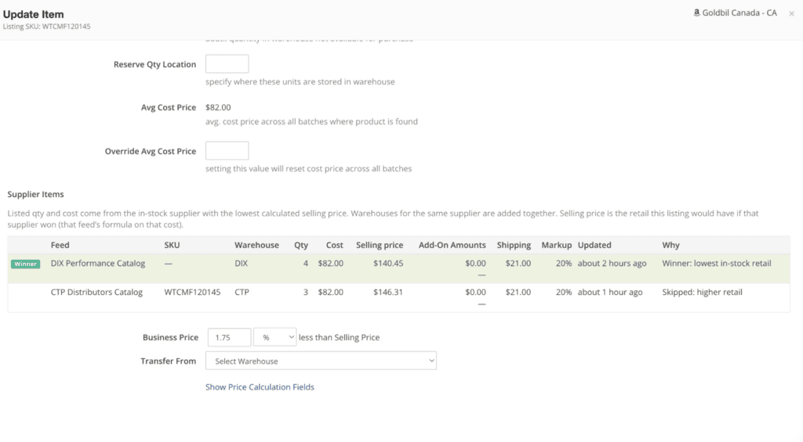
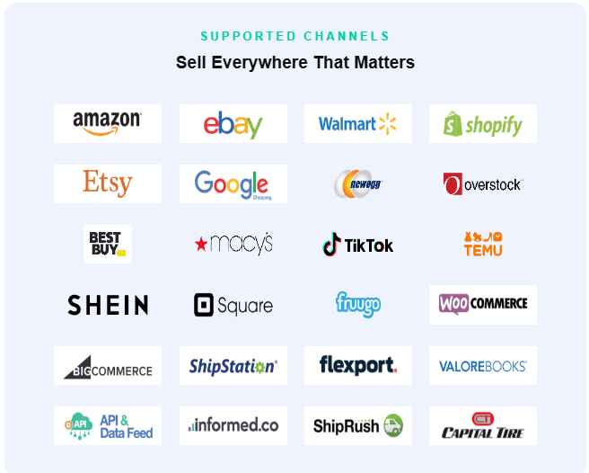

SellerChamp’s August updates focus on one goal: <b>helping sellers automate more while maintaining control.</b>

This month brings smarter supplier selection, stronger pricing safeguards, flexible fulfillment controls, and improvements across listings, catalogs, repricing, and orders.

Here’s what’s new.

<h2>Spotlight Feature
</h2>

<h3>Multiple Suppliers, One Winner
</h3>

SellerChamp can now automatically choose the best in-stock supplier when the same product is available through multiple supplier feeds.

<h3>What's New:
</h3>

Set your winning rule to the lowest supplier cost or lowest calculated selling price. SellerChamp compares available suppliers and automatically selects the winner.

You can also see each supplier’s quantity, cost, selling price, add-ons, and winning status. Separate catalog, stock, and price feeds can also be linked to one supplier record.

<h3>Why It Matters:
</h3>

You no longer have to manually compare suppliers. SellerChamp automatically uses the most competitive source while keeping supplier data transparent.

<h2>Pricing
</h2>

<h3>Hold Large Sell-Price Drops
</h3>

Unexpected feed updates can cause prices to drop too far. SellerChamp can now hold these changes before they go live.

<h3>What’s New:
</h3>

Set a price-drop limit by percentage, dollar amount, or either. Changes from feeds, CSVs, APIs, or manual edits that exceed the limit are held for review while inventory can still update.

Amazon sellers can also compare new prices against the Buy Box or average price.

<h3>Why It Matters:
</h3>

Protect your margins from accidental or unusually large price drops without stopping legitimate inventory updates.

<h2>Data Feeds
</h2>

<h3>MAP Enforcement by Manufacturer
</h3>

SellerChamp now lets you control MAP enforcement at the manufacturer level.

<h3>What's New:
</h3>

Search for manufacturers, enable or disable enforcement, and set listing-level overrides. New manufacturers default to enforced.

<h3>Why It Matters:
</h3>

Manage different MAP requirements more efficiently without manually checking individual product prices.

<h2>Fulfillment
</h2>

<h3>More Control Over Order Routing
</h3>

SellerChamp added several fulfillment controls to give sellers more flexibility over when and where orders are sent.

<h3>What's New:
</h3>

<ul>

<li>

<b>Fulfillment Holds:</b> Pause a provider while keeping assigned orders in place.</li>

<li>

<b>Confirmation Holds:</b> Auto-assign orders but require manual approval before sending.</li>

<li>

<b>Save & Send:</b> Assign and send an order to a provider in one step.</li>

<li>

<b>Tag-Based Auto-Assign:</b> Route orders only to fulfillment services with matching tags.</li>

<li>

<b>Feed-Linked Fulfillment:</b> Use a provider’s feed quantity and cost in auto-assignment decisions. </li>

</ul>

<h3>Why It Matters:
</h3>

Automate order routing while keeping a manual review step where needed. This helps ensure orders reach the right provider without unnecessary work.

<h2>Temu
</h2>

<h3>Temu Category Templates
</h3>

Creating consistent Temu listings is now easier with category-specific templates.

<h3>What's New:
</h3>

Set default option values and size charts for each Temu category. Listings in that category automatically use the selected defaults.

<h3>Why It Matters:
</h3>

Reduce repetitive data entry and maintain more consistent listings across your Temu catalog.

<h2>Amazon
</h2>

<h3>Skip Items Amazon Cannot Find
</h3>

SellerChamp now lets you skip products Amazon cannot match.

<h3>What's New:
</h3>

In Product Matcher settings, choose whether unmatched products should create a not-found listing or be skipped entirely.

<h3>Why It Matters:
</h3>

Skipping unmatched products keeps manifests cleaner and reduces unnecessary listings for your team to review.

<h2>Listings
</h2>

<h3>Invalid Listings Grouped by Reason
</h3>

Finding listing errors is now faster with grouped validation issues.

<h3>What's New:
</h3>

The Invalid tab now separates problems into secondary tabs by error type and displays a count for each.

<h3>Why It Matters:
</h3>

Work through one type of issue at a time instead of sorting through a mixed list of errors.

<h2>Listing & Manifest Improvements
</h2>

SellerChamp also improved several everyday listing workflows.

<h3>What's New:
</h3>

Sale price now syncs across all channel connections and appears in revision history. Listing fields can be accessed before selecting a category, edit windows are wider, and manifest submissions now show clearer progress.

If a winning supplier disappears from the latest feed, sellers can also choose to zero out inventory or end the listing.

<h3>Why It Matters:
</h3>

These improvements provide better visibility into pricing, supplier changes, and manifest activity while reducing manual cleanup.

<h2>Catalog
</h2>

<h3>Smarter Catalog Management
</h3>

Catalog search and matching are getting easier to manage.

<h3>What's New:
</h3>

Disconnected-channel products are removed from catalog results, UPC matching now considers title and brand similarity, and duplicate ASIN rows count as one. Category selection is now searchable, and SellerChamp suggests the next available category ID when creating categories.

<h3>Why It Matters:
</h3>

Faster matching and easier category management help sellers maintain large catalogs with less manual work.

<h2>Amazon & Repricer
</h2>

<h3>Smarter Amazon Repricing
</h3>

SellerChamp now gives sellers more control over competitor data used for repricing.

<h3>What's New:
</h3>

Ignore competitor prices that fall outside your limits or deviate too far from the median. Repricing exceptions are also grouped into one section.

CSV-provided brand and feature data is now preserved when Amazon Populate fills in catalog information.

<h3>Why It Matters:
</h3>

Filter out unrealistic competitor prices and prevent them from distorting automated repricing decisions.

<h2>eBay, Newegg & Pricing
</h2>

<h3>Channel & Pricing Improvements
</h3>

<h3>What's New:
</h3>

eBay now preserves listing condition when changing categories without a mapping. Newegg category searches follow each account’s specific category tree. Shipping costs included in pricing formulas now trigger automatic sell-price, minimum-price, and maximum-price recalculations.

<h3>Why It Matters:
</h3>

Keep listing data intact and ensure calculated prices stay accurate as shipping costs change.

<h2>Orders & Shipping
</h2>

<h3>Better Order Summaries & Labels
</h3>

<h3>What's New:
</h3>

Order and print-summary screens now have clearer sections for items, shipping, and order details. If no dedicated label printer is detected, SellerChamp defaults to standard 8.5 × 11-inch sheet labels with 30 labels per page.

<h3>Why It Matters:
</h3>

Make orders easier to review and print without requiring specialized equipment.

<h2>Did You Know?
</h2>

<h3>Winning Supplier + Price Drop Protection
</h3>

Combine automatic supplier selection with price-drop protection. SellerChamp can choose the cheapest in-stock supplier while holding the price if it falls beyond your defined threshold.

<h3>Fulfillment Hold + Tag-Based Routing
</h3>

Use tags to route orders to the right fulfillment provider, then place orders on hold for review before they are sent.

<h2>Supported Channels
</h2>

<h2>Final Thoughts
</h2>

SellerChamp’s August 2026 updates make automation safer and more flexible. From supplier selection and pricing protection to fulfillment, listings, catalog management, and repricing, sellers now have more control with fewer manual tasks.

<i>Sell more. Work less.</i>

<b>—Team SellerChamp</b>

{{ site.app.leads }}?utm_source=blog&utm_campaign=sellerchamp-august-2026-product-updates


 Azmi
