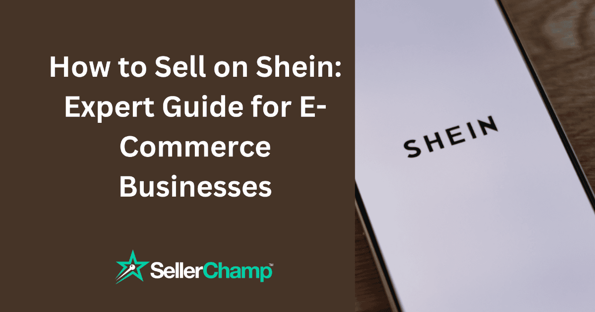
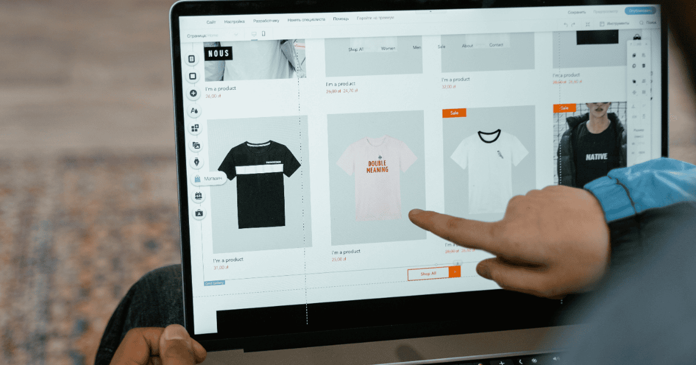

Shein counts roughly <b>17.3 million users</b> in the U.S. alone. If you’ve been trying to figure out <b>how to sell on Shein</b> and scale, this guide details everything you need to know. 

We cover details from who qualifies, <b>how the application process works</b>, and what it costs, to how to <b>manage a Shein storefront</b> alongside other marketplaces.

<strong>You might also like:</strong>

<a href="/blog/how-to-boost-ecommerce-sales-with-generative-ai/">

<b>How to Boost E-Commerce Sales With Generative AI</b>

</a>

<b>

</b>

{{ site.app.leads }}?utm_source=blog&utm_campaign=how-to-sell-on-shein


<h2>Who Can Sell on Shein?
</h2>

One important point that many <b>“how to sell on Shein</b> ” guides overlook is that Shein Marketplace has <b>specific eligibility requirements </b> for its <a href="/solutions/retail-ecommerce-solution/">

<b>e-commerce sellers</b>

</a>.

 Verify your eligibility before you start exploring selling on Shein.

<h3>Verify your eligibility before you start exploring selling on Shein. To qualify, you generally need to:
</h3>

To qualify, you generally need to:

<ul>

<li>Show a <b>minimum of $5 million in annual revenue</b> as a registered business.
<a href="https://docs.google.com/document/d/1cCUrD5cs_wWcUtpECtEgSrxd-szK7qSBV3UVWqUR-iI/edit?tab=t.0#heading=h.qtraul2boqf0">

<b>Don’t have $5 million in revenue yet? Here’s what you can do.</b>

</a>

<b>(link to internal H2)</b>

</li>

<li>Operate as a <b>legally registered company</b>. Only professional sellers are accepted.</li>

<li>Run <b>U.S.-based operations </b> and ship directly to customers from that base.</li>

<li>

<a href="/solutions/product-catalog-management/">Maintain a <b>structured product catalog</b>

</a>that fits Shein’s trend-driven, fashion-forward customer base.</li>

</ul>

<strong>Check out:</strong>

<a href="/blog/automate-multi-channel-ecommerce-operations/">

<b>How to Automate Multi-Channel E-Commerce Operations</b>

</a>

<b>

</b>

<h2>Step 1: Choose Your Niche and Products
</h2>

<h3>Pick a Niche That Fits Shein's Demographic
</h3>

<ul>

<li>

<a href="https://businessmodelcanvastemplate.com/blogs/target-market/shein-target-market?srsltid=AfmBOoobJ5UEpfdcfsTsA6IgDDiwAhsnk1H1u7awbC56AvT9e9zrfpBN">Shein’s shopper base</a> skews <b>young and trend-driven</b>. The marketplace sells multiple product categories, but <b>apparel, accessories, and beauty</b> typically convert best.</li>

<li>Go narrow before you go broad. A <b>tightly focused niche</b> (such as plus-size activewear or Y2K-inspired accessories) outperforms a scattershot catalog. </li>

<li>Cross-check your niche <b>against the best performing products</b>. For example, dresses, tops, and layered basics are consistently <b>top performers</b> on the platform; products that sit near these categories like matching accessories and layering pieces tend to <b>pick up browse traffic</b> from shoppers already there. 
</li>

</ul>

<h3>Choose Products With Built-In Demand
</h3>

<ul>

<li>Favor items with <b>high trend velocity</b>.</li>

<li>Stay in <b>Shein’s natural price band</b>. Most winning listings sit in the <b>$</b>

<b>5–$</b>

<b>25</b> range.</li>

<li>Prioritize <a href="https://www.shopify.com/pk/enterprise/blog/repeat-purchases-increase">repeat-purchase</a> and <b>add-on items</b> (jewelry, accessories, basics) over one-and-done purchases.</li>

<li>

<b>Watch shipping economics</b>. Lightweight, compact items protect your margins after commission and fulfillment costs.</li>

</ul>

<b>Pro tip:</b> Run your product list through a margin check before sourcing. Subtract Shein’s applicable commission plus fulfillment costs from your target price to confirm the math works at scale, not just per unit.

<b>Explore: </b>

<a href="/blog/how-to-calculate-profit-margins/">

<b>How to Calculate Profit Margins When Selling on Multiple Marketplaces</b>

</a>

<h2>Step 2: Find the Right Suppliers and Build Your Sourcing Strategy
</h2>

<h3>Source Product Reliably at Scale
</h3>

<ul>

<li>Vet suppliers on <b>production capacity</b>, not just unit price. Shein’s <b>flash-sale model</b> can spike demand fast, and a supplier who can’t scale will <a href="/blog/inventory-forecasting/">cost you more in stockouts</a> than they saved you per piece.</li>

<li>Order samples before committing to a minimum order quantity. Negotiate <a href="https://www.netsuite.com/portal/resource/articles/inventory-management/minimum-order-quantity-moq.shtml">MOQs</a> down wherever possible for your first run.</li>

<li>Factor <b>supplier lead time</b> into your launch timeline. <a href="https://www.liveplan.com/blog/starting/overseas-manufacturing-business-model?srsltid=AfmBOoog1SnS7l1gwW59Ex53lEOZVKtI501csUrOuY12OI8wto745tkR">Overseas manufacturing</a> typically means 30-45 day lead times; <b>domestic sourcing </b> costs more per unit but shortens that window.</li>

<li>Use an <a href="/inventory-management-api-ftp/">API for supplier-feed integration</a> and connect with multiple suppliers together.</li>

</ul>

<b>Learn more about </b>

<a href="/blog/where-to-buy-products-to-sell-online/">

<b>product sourcing and where to buy products to sell online. </b>

</a>

<h3>Validate Demand Before You Commit
</h3>

<ul>

<li>

<b>Test the product</b> on a channel you already run (Amazon, TikTok Shop, <a href="/blog/etsy-inventory-management/">Etsy</a>) before building out a full Shein catalog around it.</li>

<li>Use <b>Google Trends or other trackers</b> to confirm a trend has runway left, not just a spike.</li>

<li>Treat <b>your first Shein catalog </b> as a pilot: 15-25 tightly curated SKUs validated elsewhere might outperform 100 untested ones.</li>

</ul>

<strong>You might also like:</strong>

<a href="/blog/how-to-optimize-for-serp-features-ecommerce/">

<b>How Can Ecommerce Sellers Optimize for SERP Features?</b>

</a>

<h2>Step 3: Apply to Become a Seller on Shein
</h2>

<h3>How to Sell on Shein: Step-by-Step Signup Process
</h3>

Once you’ve confirmed you meet the requirements, the application itself is fairly straightforward.

<h3>i. Head to the official Shein Seller Portal
</h3>

Go to <a href="https://seller-us.shein.com/signup">seller-us.shein.com/signup</a> and start your application. It’s a short application and a Shein representative will get in touch with you within 1 business day of its submission.

<h3>ii. Submit your business documentation
</h3>

<ul>

<li>Certificate or Articles of Incorporation</li>

<li>Most recent W-9 (U.S. businesses)</li>

<li>Trademark registration certificate, if applicable</li>

<li>Government-issued ID or passport (front and back) for your company representative</li>

<li>Store logo (high quality PNG)</li>

</ul>

<h3>iii. Get matched with an account manager
</h3>

Shein pairs approved applicants with a <b>dedicated account manager</b> who guides onboarding and other processes. Most storefronts go live within a few days once documents are verified.

<h3>iv. Build your catalog and launch
</h3>

Upload product data, pricing, and imagery, then <b>set your storefront live</b>. This is where e-commerce sellers running <a href="/blog/automate-multi-channel-ecommerce-operations/">multiple channels</a> tend to feel the most friction; consider <a href="/features/">multiple-channel automation tools</a> to simplify the processes.

<strong>Check out:</strong>

<a href="/blog/best-ecommerce-automation-platform-tools-2025/">

<b>Best Rated E-Commerce Automation Platforms and Tools [Updated]</b>

</a>

<b>

</b>

<h2>Step 4: Listing Guidelines: Learn What Sells (and What Gets Rejected) and Work Accordingly
</h2>

Shein’s customer base skews <b>young, mobile-first, and trend-driven</b>; your listings need to align with those market expectations.

<ul>

<li>Go for <b>high-quality, well-lit product photography</b> that accurately represents the product.</li>

<li>Use accurate <b> size charts and material details</b> in your <a href="/blog/best-ecommerce-product-listing-services/">product listings</a> to cut down on returns.</li>

<li>Follow <b>competitive, trend-aware pricing</b>. Shein shoppers are generally price-sensitive. Use a <a href="/repricer-software/">repricer tool</a> to maintain optimal prices at all times. </li>

</ul>

<b>Learn more on </b>

<a href="/blog/automate-product-listings/">

<b>how to automate product listings across marketplaces</b>

</a>

<h2>Don’t Have $5 Million in Revenue Yet? Here’s What You Can Do
</h2>

If the <b>revenue threshold</b> rules you out of <b>Shein Marketplace</b> directly, you’re not necessarily locked out of the ecosystem.

<ul>

<li>

<b>Independent fashion designers and artists</b> can explore <a href="https://www.discoversheinx.com/">SHEIN X</a>, an incubator program which operates <b>separately from the standard Shein Marketplace</b> seller process. Shein X <b>provides selected participants </b> with resources such as manufacturing, marketing, and operational support to help bring their designs to market.</li>

<li>

<b>Grow through adjacent channels</b> first: build volume on <a href="/blog/best-amazon-inventory-management-software-multi-channel/">Amazon</a>, Walmart, or <a href="/blog/how-to-sell-on-tiktok-shop-2/">TikTok </a>Shop, then reapply once revenue supports it.</li>

<li>

<b>Watch for tier changes</b>: marketplace requirements shift as platforms mature, so requirements are worth revisiting every few quarters.</li>

</ul>

<b>Explore: </b>

<a href="/blog/best-multi-channel-ecommerce-platform/">

<b>10 Best Multichannel E-Commerce Platforms</b>

</a>

<b>

</b>

<h2>Key Things to Know to Sell on Shein
</h2>

<h3>Shein Seller Fees and Commission Structure
</h3>

Shein Marketplace runs on a <b>commission model</b> rather than flat monthly fees.

<ul>

<li>

<b>Commission rate</b>: <b>approximately 10%</b> per sale <b> depending on the product category</b>.</li>

<li>

<b>No upfront listing fees</b>: you’re not charged simply for creating a storefront or uploading products.</li>

<li>

<b>Fulfillment costs vary:</b> self-fulfillment versus Shein’s own fulfillment service carry different cost structures. </li>

</ul>

<strong>You might also like:</strong>

<a href="/blog/how-can-ecommerce-players-increase-profit-margin/">

<b>How Can E-Commerce Players Increase Contribution Margin?</b>

</a>

<h3>Shein Fulfillment Service (SFS): Should You Use It?
</h3>

Shein Fulfillment Service works similarly to <a href="/solutions/amazon-seller-software-for-fba/">Amazon FBA</a>. Approved sellers store inventory in <b>Shein’s warehouses</b>, and Shein handles <b>picking, packing, shipping, and returns</b>.

<b>SFS makes sense for e-commerce sellers who:</b>

<ul>

<li>
Want to <b>compete on delivery speed</b>.</li>

<li>
Prefer to <b>offload pick-pack-ship work</b> the way you might with FBA.</li>

<li>
Sell <b>fast-moving, trend-cycle products</b> where speed drives conversion.</li>

</ul>

<strong>Check out:</strong>

<a href="/blog/ecommerce-fulfillment-services-guide-best-options/">

<b>E-Commerce Fulfillment Services Guide: Best Options for E-Commerce Fulfillment</b>

</a>

<b>

</b>

<h2>Common Mistakes to Avoid When Selling on Shein
</h2>

<ul>

<li>

<b>Underestimating the eligibility bar</b>

</li>

</ul>

Applying before you meet Shein’s eligibility requirements can delay your onboarding process. Build the case first.

<ul>

<li>

<b>Treating it like a side-channel</b>

</li>

</ul>

Sellers who simply re-use listings from other channels, without adjusting tone, imagery, or pricing tend to underperform.

<ul>

<li>

<b>Letting inventory drift out of sync</b>

</li>

</ul>

Overselling on a fast-moving platform like Shein damages your seller rating quickly. Real-time sync isn’t optional at scale.

<b>Explore: </b>

<a href="/blog/ecommerce-site-search/">

<b>17 Ecommerce Site Search Best Practices and Tactics</b>

</a>

<h2>Managing Shein Alongside Your Other Sales Channels
</h2>

Running Shein well while also managing Amazon, eBay, Walmart, or <a href="/blog/shopify-inventory-management-prevent-overselling/">Shopify</a> listings manually can get messy.

Every channel requires slightly different <b>product data, images, and pricing rules</b>, and <a href="/blog/inventory-forecasting/">inventory</a> has to <b>stay accurate</b> everywhere at once, or you risk overselling.

<ul>

<li>

<a href="/bulk-lister-seller-champ/">

<b>Bulk Lister</b>

</a>

<b>. </b> Upload and manage <b>thousands of Shein-ready listings</b> in minutes instead of building each one by hand.</li>

<li>

<a href="/inventory-sync-software/">

<b>Inventory Sync</b>

</a>

<b>. </b> Keep <b>stock levels accurate in real time</b> across Shein and every other channel you sell on.</li>

<li>

<a href="/multi-channel-fulfillment-software/">

<b>Multi-Channel Fulfillment.</b>

</a>
Route orders automatically whether you’re <b>self-fulfilling or using SFS.</b>

</li>

<li>

<a href="/repricer-software/">

<b>RePricer Software</b>

</a>. Stay competitive on Shein’s <b>price-sensitive shoppers</b> without manually adjusting prices all day.</li>

<li>

<a href="/repricer-software/">

<b>Insights & Reports</b>

</a>

<b>. </b> Get detailed but <b>easy-to-understand reports</b> on your sales and revenue. 
</li>

</ul>

<h2>Frequently Asked Questions (FAQs)
</h2>

<h3>Q: Is Shein Marketplace worth it for small brands?
</h3>

Yes, Shein Marketplace can be worthwhile for small brands that meet its seller requirements and can compete on pricing, product selection, and fulfillment. Shein offers access to a large audience that can help small brands grow fast.

<h3>Q: Can I sell on Shein without holding inventory?
</h3>

It depends on Shein’s current fulfillment requirements. Sellers may use third-party fulfillment services, but the arrangement must meet Shein’s shipping, inventory, and order-processing requirements.

<h3>Q: What products are prohibited on Shein Marketplace?
</h3>

Shein prohibits products that violate its policies, applicable laws, intellectual property rights, or safety requirements. This can include counterfeit, infringing, unsafe, and certain regulated products.

<h3>Q: Can I sell the same products on Shein and Amazon?
</h3>

Yes. You can sell across both marketplaces, but each platform may have different listing, pricing, and fulfillment requirements. Keep your inventory synchronized to avoid overselling.

<h3>Q: How do sellers handle returns on Shein?
</h3>

Sellers must follow Shein’s return policies and handle eligible returns according to the platform’s requirements via the Seller Hub. If you use Shein Fulfillment Service (SFS), Shein manages the return process as part of its fulfillment service.

<h2>

<a href="https://app.sellerchamp.com/leads/new">Want to see it in action? </a>

</h2>

<h5>Book a Sellerchamp demo
</h5>

<a style="color: #ffffff;" href="https://app.sellerchamp.com/leads/new">

<b>Schedule a SellerChamp demo and discover how bulk listing and inventory sync work together across Shein and every other marketplace you run. </b>.</a>

Azmi
