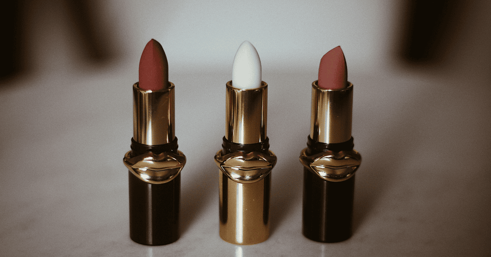
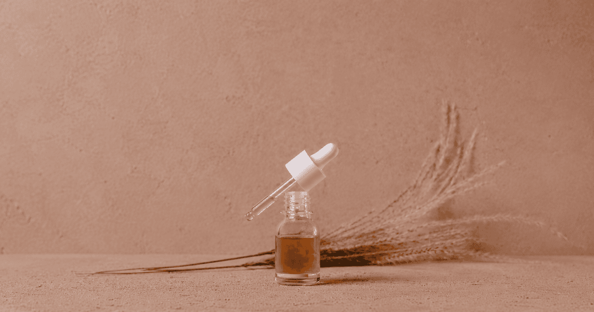
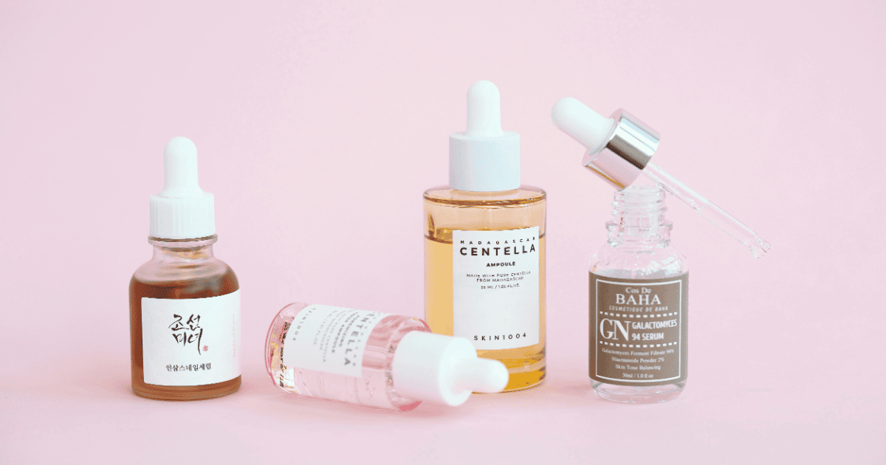
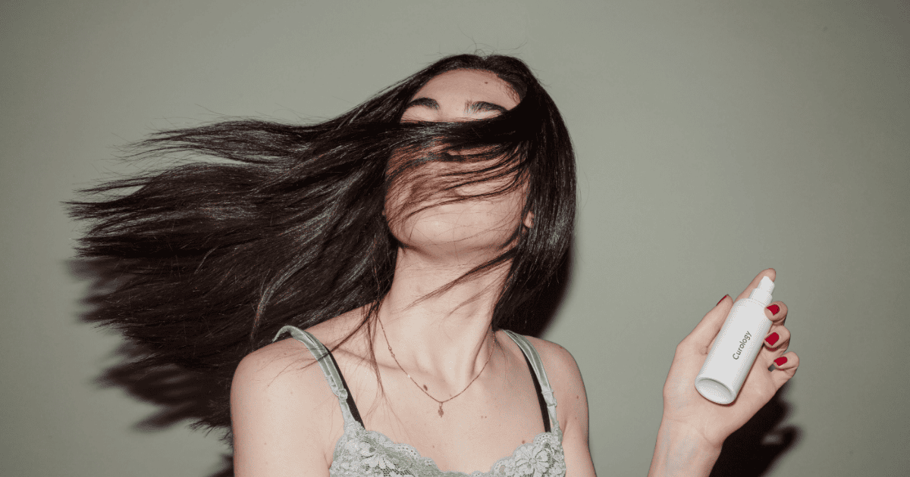
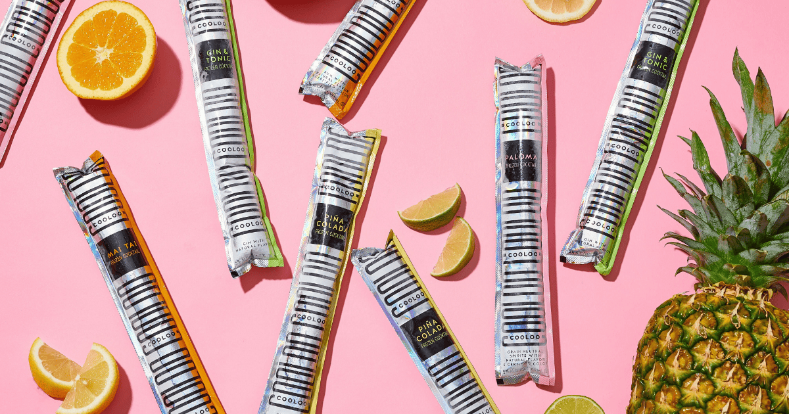
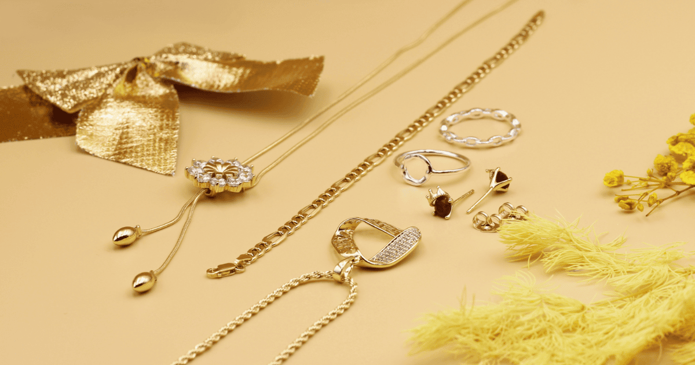
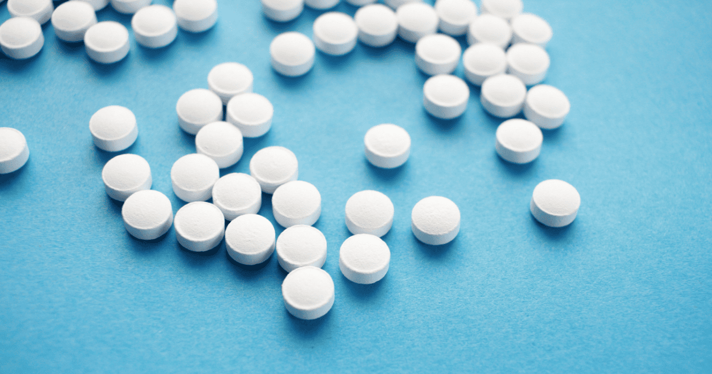
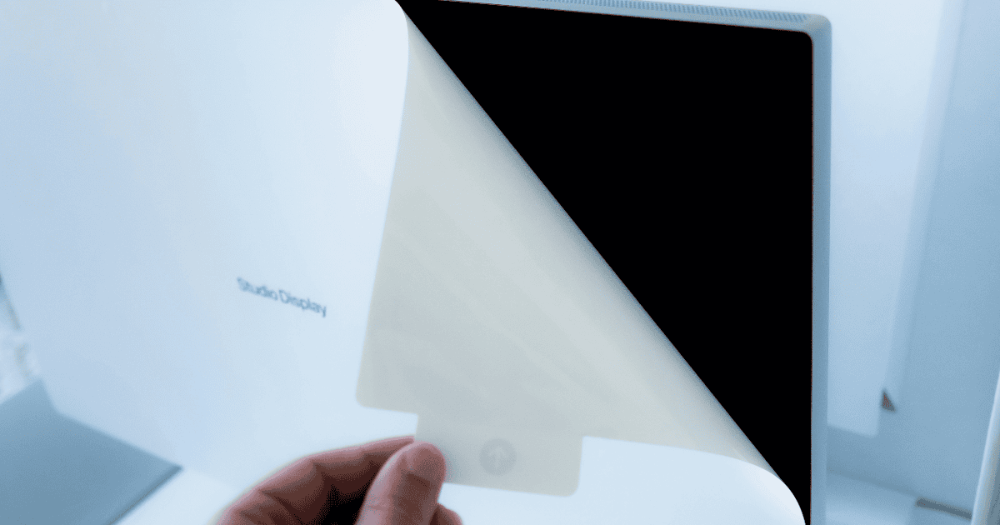
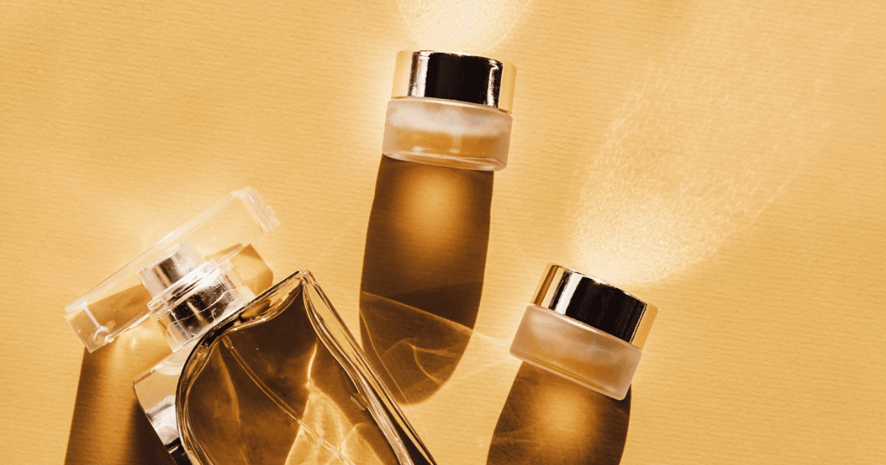

TikTok has grown from a video platform into a major shopping channel, helping products go viral while also generating significant sales. For sellers, tracking the <b>top selling products on TikTok</b> can reveal categories with <b>strong demand</b>, creator appeal, and <b>repeat-purchase</b> potential.

In this blog, we explore <b> 12 high-demand products</b>, their latest sales signals, and <b>why they work on TikTok Shop</b> in 2026.

<strong>You might also like:</strong>

<a href="/blog/how-to-sell-on-tiktok-shop-2/">

<b>How to Sell on TikTok Shop: Step-by-Step Seller Guide</b>

</a>

<b>

</b>

{{ site.app.leads }}?utm_source=blog&utm_campaign=top-selling-products-on-tiktok


<h2>1. Lip Makeup Products
</h2>

<ul>

<li>

<b>Category: </b>

</li>

</ul>

Beauty

<ul>

<li>

<b>Sales signal:</b>

</li>

</ul>

Lip Liner <b> Stay-N-Peel</b>

<a href="https://www.helium10.com/blog/top-20-best-selling-products-on-tiktok-shop/">generated $46.6M</a> in 2025, the single highest-grossing tracked product on the platform.
<a href="https://newsroom.tiktok.com/tiktok-shopping-report?lang=en-GB">TikTok’s own Shopping Report
</a>separately names <b>Wonderskin Lip Stain</b> and <b>P.Louise’s “Bad B*tch” Lip Duo </b> as trending, with Wonderskin Lipstain being sold once every 5 seconds.

<ul>

<li>

<b>Why it works: </b>

</li>

</ul>

The format is almost tailor-made for short-form video: apply, peel, reveal. It gives creators an immediate visual payoff and a simple demonstration.

<h2>2. Serums & Essences
</h2>

<ul>

<li>

<b>Category: </b>

</li>

</ul>

Beauty / Skincare

<ul>

<li>

<b>Sales signal: </b>

</li>

</ul>

Beauty remains <a href="/blog/how-to-sell-on-tiktok-shop/">TikTok Shop’s</a>

<b>highest-converting category</b>, and <a href="https://www.kalodata.com/blog/tiktok/the-2026-tiktok-shop-goldmine-20-best-selling-products-the-data-behind-the-viral-trends/#Beauty_Personal_Care_Why_%E2%80%9CPeelable%E2%80%9D_and_%E2%80%9CTransformative%E2%80%9D_Win">Kalodata’s 2026 category analysis</a> specifically identifies <b>visibly transformative skincare</b> as the strongest sub-pattern, converting 3-4x above platform average.

<ul>

<li>

<b>Why it works:</b>

</li>

</ul>

Skincare products fit naturally into TikTok’s <b>routine-based and educational</b> content. Visible textures, application techniques, and <b>before-and-after demonstrations</b> can make serums and essences highly engaging.

<h2>3. K-Beauty Skincare Sets
</h2>

<ul>

<li>

<b>Category: </b>

</li>

</ul>

Beauty / Skincare

<ul>

<li>

<b>Sales signal: </b>

</li>

</ul>

Beauty remains <a href="/blog/how-to-sell-on-tiktok-shop/">TikTok Shop’s</a>

<b>highest-converting category</b>, and <a href="https://www.kalodata.com/blog/tiktok/the-2026-tiktok-shop-goldmine-20-best-selling-products-the-data-behind-the-viral-trends/#Beauty_Personal_Care_Why_%E2%80%9CPeelable%E2%80%9D_and_%E2%80%9CTransformative%E2%80%9D_Win">Kalodata’s 2026 category analysis</a> specifically identifies <b>visibly transformative skincare</b> as the strongest sub-pattern, converting 3-4x above platform average.

<ul>

<li>

<b>Why it works:</b>

</li>

</ul>

Skincare products fit naturally into TikTok’s <b>routine-based and educational</b> content. Visible textures, application techniques, and <b>before-and-after demonstrations</b> can make serums and essences highly engaging.

<h2>4. Hair Growth Products
</h2>

<ul>

<li>

<b>Category: </b>

</li>

</ul>

Health & Wellness

<ul>

<li>

<b>Sales signal: </b>

</li>

</ul>

MaryRuth’s liquid multivitamin and hair-growth product <a href="https://www.helium10.com/blog/top-20-best-selling-products-on-tiktok-shop/#3-maryruths-liquid-multivitamin-hair-growth">generated about $29.9</a> million, showing a strong crossover between <b>haircare and supplement content</b>.

<ul>

<li>

<b>Why it works: </b>

</li>

</ul>

Hair-growth products are easy to demonstrate through <b> application videos</b>, hair-care routines, <b>ingredient breakdowns</b>, and product comparisons.

<b>Explore: </b>

<a href="/blog/best-selling-items-on-temu/">

<b>20 Best Selling Items on Temu [Updated]</b>

</a>

<h2>5. Supplements
</h2>

<ul>

<li>

<b>Category: </b>

</li>

</ul>

Health & Wellness

<ul>

<li>

<b>Sales signal: </b>

</li>

</ul>

<b>BetterAlt Gold+ Shilajit Honey Sticks</b> generated about $14.5 million on TikTok Shop. These sticks have been going <b>viral on TikTok </b> as well as in other wellness spaces. Similarly, <a href="https://www.tiktok.com/@golinutrition?lang=en">Goli Nutrition</a>

<b>generated $4M</b> in only 30 days selling vitamins.

<ul>

<li>

<b>Why it works: </b>

</li>

</ul>

Single-serve formats are convenient for creator demonstrations and routine-based content.

<h2>6. Womenswear & Underwear
</h2>

<ul>

<li>

<b>Category: </b>

</li>

</ul>

Fashion / Womenswear

<ul>

<li>

<b>Sales signal:</b>

</li>

</ul>

Womenswear & Underwear ranks as <a href="https://www.statista.com/statistics/1461497/category-tiktok-shops-worldwide/">TikTok Shop’s #2 category worldwide</a> by <b> GMV</b>. It is also the single largest category by <b>number of active TikTok Shop</b> storefronts globally.

<ul>

<li>

<b>Why it works: </b>

</li>

</ul>

Fashion trends are constantly changing, giving shoppers <b>new styles to discover</b>. TikTok Shop helps trending clothing <b>gain visibility</b> through styling, try-on, and creator content.

<strong>You might also like:</strong>

<a href="/blog/automate-multi-channel-ecommerce-operations/">

<b>How to Automate Multi-Channel E-Commerce Operations</b>

</a>

<h2>7. Women’s Bodysuits
</h2>

<ul>

<li>

<b>Category: </b>

</li>

</ul>

Fashion

<ul>

<li>

<b>Sales signal:</b>

</li>

</ul>

Sitting between womenswear & underwear, bodysuits make for a <b>versatile, easy-to-market product</b>. <a href="https://www.tiktok.com/t/ZP9N8VVhUQaGo-9Ghe5">OQQfitness’ three-piece bodysuit set</a> has sold <b>more than 500,000 units on TikTok Shop</b>, making it one of the platform’s standout womenswear products.

<ul>

<li>

<b>Why it works: </b>

</li>

</ul>

Bodysuits combine <b>fashion and function</b> in a format that is easy to demonstrate in short-form content. Their <b>fitted silhouette</b> creates a clean, tucked-in look, while different cuts can be styled with jeans, skirts, trousers, or layered under jackets.

<h2>8. Necklaces, Rings & Jewelry
</h2>

<ul>

<li>

<b>Category: </b>

</li>

</ul>

Fashion Accessories

<ul>

<li>

<b>Sales signal: </b>

</li>

</ul>

The <a href="https://www.statista.com/outlook/cmo/accessories/watches-jewelry/jewelry/worldwide/?srsltid=AfmBOoqE1JZ3YlWGPzm0svcsp0okMTro8Mx_BiXlm5QX9Cdu-z5B83xb">global jewelry market</a> is huge, with expected <b>total revenue</b> generation to reach <b>$408.6bn by the end of 2026</b>. Jewelry like rings and necklaces are exceptional products to sell on TikTok Shop due to their <b> high profit margins</b>, lightweight shipping economics, and <b>massive visual appeal</b> on short-form video.

<ul>

<li>

<b>Why it works:</b>

</li>

</ul>

Jewelry is highly visual, making it <b>easy to showcase</b> through styling, unboxing, and try-on content. Its <b>lightweight design</b> and relatively low shipping costs also make it attractive for online sellers.

<strong>Check out:</strong>

<a href="/blog/how-to-boost-ecommerce-sales-with-generative-ai/">

<b>How to Boost E-Commerce Sales With Generative AI</b>

</a>

<b>

</b>

<h2>9. Toothpaste Tablets
</h2>

<ul>

<li>

<b>Category: </b>

</li>

</ul>

Oral Care

<ul>

<li>

<b>Sales signal: </b>

</li>

</ul>

<b>NOBS </b>

<a href="https://www.persistencemarketresearch.com/market-research/toothpaste-tablets-market.asp">

<b>Toothpaste Tablets</b>

</a> became the No. 1 most sold item on TikTok Shop in December 2025. They’re also in the <b>top-15 ranking on Amazon</b>. The market is expected to cross <b>$86.4mn by this year,</b> with 55% of it being captured by <b>fluoride-free tablets</b>.

<ul>

<li>

<b>Why it works: </b>

</li>

</ul>

The format is visually <b>interesting to shoot</b>, and easy to explain as an alternative to conventional toothpaste. The product itself is compact, often being sold as multiple units per order, and leads to sizable profits.

<h2>10. Screen Protector
</h2>

<ul>

<li>

<b>Category: </b>

</li>

</ul>

Tech Accessories

<ul>

<li>

<b>Sales signal: </b>

</li>

</ul>

Screen protectors are a <b>goldmine for sellers on TikTok Shop</b>. <a href="https://influencermarketinghub.com/tiktok-shop-campaigns-electronics-gadgets/">Tech accessories and electronics</a> make up <b>28% of all TikTok Shop sales</b>; screen protectors are a small, repeat-buy product in this market, with a huge consumer demand.

<ul>

<li>

<b>Why it works: </b>

</li>

</ul>

Screen protectors are <b>compact, practical, and highly demonstrable</b>. Installation videos also create a strong before-and-after format.

<b>Explore: </b>

<a href="/blog/best-ecommerce-product-listing-services/">

<b>10 Best E-Commerce Product Listing Services [Updated]</b>

</a>

<b>

</b>

<h2>11. Earphones & Headphones
</h2>

<ul>

<li>

<b>Category: </b>

</li>

</ul>

Phones & Electronics

<ul>

<li>

<b>Sales signal: </b>

</li>

</ul>

Earphones and headphones rank among the <b>top-performing small electronics </b> on<a href="https://shop.tiktok.com/us/k/tiktok-shop-earphones">

TikTok Shop</a>, generating <b>estimated sales</b>

<b>volumes </b> upwards of <b>17 million units globally</b>. Overall, consumer electronics bring around <a href="https://www.oberlo.com/statistics/top-selling-tiktok-products">25% of all social shopping purchases</a>.

<ul>

<li>

<b>Why it works:</b>

</li>

</ul>

Earphones and headphones combine <b>everyday utility </b> with strong visual appeal in short-form videos. Features like sound quality, <b>noise cancellation</b>, and sleek designs are easy for creators to demonstrate and compare.

<h2>12. Perfume
</h2>

<ul>

<li>

<b>Category:</b>

</li>

</ul>

Beauty / Fragrance

<ul>

<li>

<b>Sales signal:</b>

</li>

</ul>

Fragrance generated <b>more than $162 million in </b>

<a href="https://www.beautyindependent.com/top-10-brands-driving-fragrance-sales-tiktok-shop/">

<b>TikTok Shop sales</b>

</a>

<b> in 2025</b>. Individual brands have also shown <b>strong performance</b>, with Lattafa reporting $54mn in sales.

<ul>

<li>

<b>Why it works:</b>

</li>

</ul>

Perfume works particularly well on TikTok because creators can sell a fragrance through <b>storytelling, reviews, and comparisons</b> even though shoppers cannot smell the product.

<h2>Frequently Asked Questions (FAQs)
</h2>

<h3>Q: How often does the list of top selling products on TikTok change?
</h3>

Trending categories can shift within weeks as new creators and sounds drive discovery, but core categories like beauty, wellness, and fashion tend to stay consistently strong quarter over quarter.

<h3>Q: Do I need to source these exact products, or can I sell similar alternatives?
</h3>

You don’t need the exact SKU that’s going viral. Selling a comparable product in the same category can still capture demand, as long as your listing, pricing, and content align with what’s already resonating with shoppers.

<h3>Q: Is TikTok Shop only profitable for products that go viral?
</h3>

No. While viral moments boost visibility, many sellers build steady revenue from repeat-purchase, low-cost items like screen protectors or toothpaste tablets that don’t need to go viral to sell consistently.

<h3>Q: What's the minimum order quantity or investment needed to test a trending product?
</h3>

This varies by supplier, but many sellers test trending categories with small batch orders before scaling. Categories with low per-unit cost and high shipping efficiency, like jewelry or oral care, are typically lower-risk for testing.

<h3>Q: Can I sell these product categories on other marketplaces besides TikTok Shop?
</h3>

Yes. Categories like beauty, wellness, and fashion accessories perform well across Amazon, Walmart, and eBay too, which makes them a strong fit for sellers running multi-channel operations rather than relying on a single platform.

<h3>Q: How can I list and manage trending products across TikTok Shop and other channels efficiently?
</h3>

Tools like SellerChamp allow sellers to sync inventory, manage listings, and push products across multiple marketplaces from one dashboard, reducing the manual work of testing new trending categories individually.

<h2>

<a href="https://app.sellerchamp.com/leads/new">Ready to Turn TikTok Trends Into Sales?</a>

</h2>

Finding the <b>top selling products on TikTok</b> is only the first step. The right tools can help you source products, manage listings, and <b>scale your e-commerce business</b> more efficiently.

<h5>Sell smarter across multiple marketplaces
</h5>

<a style="color: #ffffff;" href="https://app.sellerchamp.com/leads/new">

<b> Explore SellerChamp’s retail e-commerce solution and simplify your business operations.</b>

</a>

Azmi
